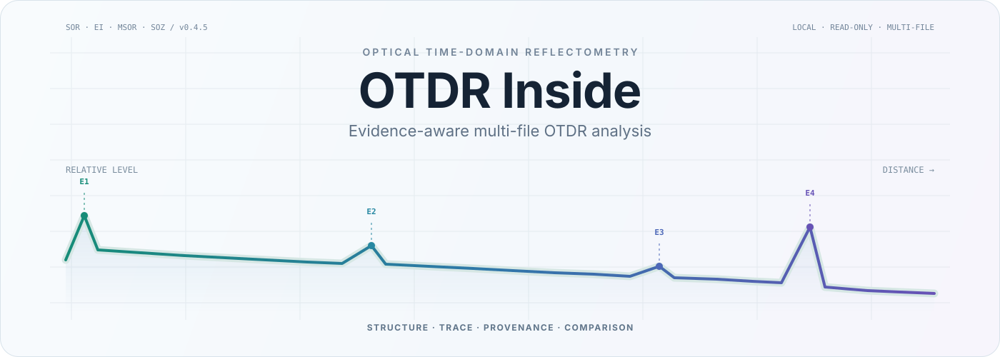
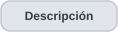
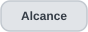
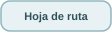
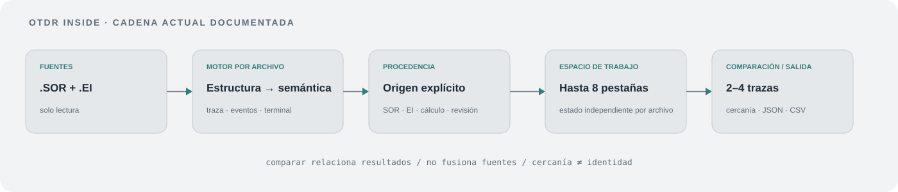
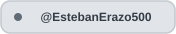

<p align="center">
  <picture>
    <source media="(prefers-color-scheme: dark)" srcset="https://raw.githubusercontent.com/EstebanErazo500/OTDR_Inside/main/assets/otdr-hero.svg">
    <source media="(prefers-color-scheme: light)" srcset="https://raw.githubusercontent.com/EstebanErazo500/OTDR_Inside/main/assets/otdr-hero-light.svg">
    
  </picture>
</p>

<p align="center">
  <strong>Análisis OTDR multiarchivo con evidencia y procedencia explícitas.</strong><br>
  Lectura SOR segura, interpretación por fabricante, análisis emparejado EI/SOR, reconstrucción de trazas y comparación sin perder el origen de los datos.
</p>

<p align="center">
  <a href="#descripción-general"></a>
  <a href="#arquitectura"></a>
  <a href="#capacidades-actuales"></a>
  <a href="#alcance-actual"></a>
  <a href="#validación"></a>
  <a href="#hoja-de-ruta"></a>
  <a href="technical-documentation/README.es.md"></a>
</p>

<p align="center">
  <a href="README.md"></a>
  <a href="README.es.md"></a>
</p>

---

<h2 id="descripción-general" align="center">Descripción general</h2>

Un archivo OTDR puede ser estructuralmente legible y, aun así, contener semántica específica del fabricante, metadatos reescritos, escalas ambiguas o distintas representaciones de eventos. OTDR Inside aborda ese problema separando **estructura**, **interpretación**, **cálculo**, **evidencia**, **procedencia** y, desde la línea 0.4, **estado de comparación**.

El proyecto no intenta forzar todas las trazas dentro de un modelo universal. Expone qué se leyó, qué se interpretó, cómo se obtuvo un resultado, a qué fuente pertenece y qué afirmaciones siguen sin resolverse.

<h2 id="arquitectura" align="center">Arquitectura</h2>

<p align="center">
  
</p>

La línea documentada separa el análisis por archivo del espacio de trabajo que presenta y compara resultados:

| Capa | Responsabilidad |
|---|---|
| **Lectura estructural** | Lee bloques SOR, revisiones, tamaños, offsets y regiones de muestras con comprobaciones explícitas de límites. |
| **Perfil y normalización** | Aplica reglas de fabricante solo cuando la evidencia disponible las respalda. |
| **Análisis por archivo** | Reconstruye la traza, conserva orígenes almacenados/importados/calculados y evalúa evidencia de eventos y terminal. |
| **Espacio de trabajo** | Mantiene hasta ocho análisis en pestañas independientes con zoom, selección, revisión y anotaciones propias. |
| **Comparación** | Compara de dos a cuatro trazas como relación de presentación sin fusionar su procedencia ni afirmar identidad física. |

La evolución completa y la instantánea detallada de v0.4.1 están en <a href="technical-documentation/architecture.es.md">Documentación técnica</a>.

<h2 id="enfoque-de-ingeniería" align="center">Enfoque de ingeniería</h2>

Cinco distinciones guían la implementación:

- **La estructura no es la semántica.** Un archivo puede leerse correctamente mientras algunas magnitudes permanecen sin interpretar.
- **El equipo no es necesariamente quien escribió el archivo.** Los bloques propietarios pueden identificar un linaje de software sin demostrar qué OTDR adquirió la traza.
- **Lo almacenado no es lo calculado.** Los resultados del análisis permanecen diferenciados de la información presente en la medición.
- **Cercanía no es identidad.** Posiciones próximas entre trazas sirven para revisar, pero no prueban el mismo evento físico, enlace o exactitud.
- **Desconocido no significa corrupto.** La semántica no soportada permanece explícita en lugar de ser adivinada.

### Normalización con procedencia

*Esquema conceptual ilustrativo; no corresponde al código fuente de la aplicación:*

```python
normalized_field = {
    "value": ...,
    "raw_value": ...,
    "unit": ...,
    "source": ...,
    "rule_id": ...,
    "confidence": ...,
    "evidence": ...,
}
```

Así, una conversión empírica, una escala de fabricante o una interpretación inferida siguen diferenciadas de un valor almacenado explícitamente.

<h2 id="capacidades-actuales" align="center">Capacidades actuales</h2>

La línea archivada documentada hasta **v0.4.2** incluye:

- inspección segura de estructura y metadatos SOR 2.00;
- selección de perfiles caracterizados basada en evidencia;
- reconstrucción de trazas desde las muestras almacenadas;
- lectura defensiva de `.EI` para el diseño CE6422 caracterizado y emparejamiento EI/SOR basado en evidencia;
- separación explícita entre eventos almacenados en SOR, registros importados de EI, candidatos calculados y revisión manual;
- análisis contextual de eventos, exclusiones explicables y evidencia terminal;
- estabilización v0.3.6 de curvas EI/SOR equivalentes y localización de respuestas débiles;
- hasta **ocho archivos abiertos en pestañas independientes** desde v0.4.0;
- asociación EI iniciada explícitamente desde una pestaña SOR, no por semejanza del nombre;
- comparación de **dos a cuatro trazas** con condiciones de adquisición, superposición, cercanía de eventos y exportación CSV;
- en v0.4.1, comparación entre cualquier par seleccionado, vistas **tramo común / recorrido completo** y referencia gráfica por mediana entre 5 y 50 m;
- en v0.4.2, auditoría de comparación con grados de evidencia y **candidatos excluidos cercanos**, sin contarlos como coincidencias;
- avisos de sensibilidad terminal al variar ±10 % el umbral mínimo de ruido **sin modificar la decisión predeterminada del detector**;
- **localizador experimental de borde por clase**, opcional y reversible, con posiciones base conservadas y método registrado en sesiones y exportaciones;
- mejoras de informes/PDF y controles de sesión, manteniendo el tratamiento de solo lectura;
- diagnóstico organizado en datos leídos, hallazgos accionables, advertencias y detalle metodológico;
- exportaciones JSON/CSV sin modificar la medición original.

<h2 id="alcance-actual" align="center">Alcance actual · documentado hasta v0.4.2</h2>

| Ecosistema | Estado | Papel dentro del proyecto |
|---|---|---|
| **EXFO** | **Referencia validada** | Lectura SOR 2.00, parámetros normalizados, eventos almacenados y visualización para el perfil de referencia caracterizado. |
| **Ceyear CE6422** | **Desarrollo activo** | Interpretación de traza, candidatos calculados, emparejamiento EI/SOR verificado para el diseño observado, diagnóstico terminal y comparación multiarchivo. |
| **Yokogawa AQ1000** | **Estructural** | Estructura caracterizada; la normalización semántica específica del fabricante sigue pendiente. |

<p align="center"><strong>estructuralmente legible → perfil identificado → caracterizado semánticamente → validado empíricamente</strong></p>

<h2 id="procedencia-de-eventos" align="center">Procedencia de eventos</h2>

El origen permanece como parte del modelo:

- **Almacenado en SOR** — información de evento serializada, como `KeyEvents` cuando existe;
- **Importado de EI** — registros leídos de un diseño EI soportado, con estado de pareja verificada separado;
- **Candidato calculado** — hipótesis derivadas de la curva, incluidos candidatos terminales;
- **Revisión manual** — estado o anotación del usuario que no altera la medición fuente.

El espacio de trabajo v0.4 añade otra regla: colocar varias trazas en una comparación **no crea una procedencia nueva**. v0.4.1 agrupa posiciones cercanas para revisión y conserva el archivo fuente y el origen de cada elemento. v0.4.2 muestra propuestas excluidas cercanas y su motivo **sin presentarlas como coincidencias aceptadas**. Un desplazamiento experimental sigue siendo calculado y conserva posición base y método.

En la familia Ceyear caracterizada, la ausencia de `KeyEvents` significa que **no se encontró una tabla almacenada en ese SOR**; no significa que la traza óptica carezca de eventos.

<h2 id="validación" align="center">Validación</h2>

La validación se organiza por capas:

1. comprobaciones estructurales y de límites;
2. regresión de perfiles y semántica;
3. reconstrucción de traza y regresión determinista de eventos;
4. consistencia EI/SOR cuando existe una pareja verificada;
5. comparaciones privadas de campo/referencia conservando sus límites;
6. regresión de espacio de trabajo, servidor y DOM/canvas simulado;
7. comprobaciones manuales del visor y exportaciones.

Entre los hitos documentados están una validación de liberación de **80 pruebas en v0.3.6**, comprobaciones sobre **18 parejas EI/SOR controladas** con 72/72 asociaciones de eventos posteriores al inicio y, en v0.4.1, una suite estándar de **54 pruebas aprobadas con 6 pruebas de corpus externo omitidas**. Los conteos no se presentan como una puntuación comparable de calidad porque las suites y los datos requeridos cambiaron entre entregas.

La revisión de presentación archivada de v0.4.2 registra **92 pruebas Python aprobadas con los corpus controlados/privados disponibles** y pruebas DOM simuladas. El localizador de borde por clase mejora la *concordancia retrospectiva* frente a la referencia EXFO del estudio, pero empeora frente a EI emparejado; por eso permanece **experimental y desactivado por defecto**, sin presentarse como mejora de exactitud física.

La jerarquía de evidencia, la frontera público/privado y los límites metrológicos están descritos en <a href="technical-documentation/validation.es.md">Validación</a>.

<h2 id="manejo-de-datos" align="center">Manejo de datos</h2>

OTDR Inside está diseñado como un flujo **local y de solo lectura**. Las mediciones fuente se procesan localmente y el visor no sobrescribe los originales.

**Alcance permitido:** capturas revisadas del visor real, explicaciones de arquitectura de alto nivel e ilustraciones generales/completamente sintéticas. **No está autorizada la publicación del código fuente del visor**, incluso si se limpia o adapta, ni de sus pruebas/configuración interna, binarios o releases ejecutables. Cada captura debe revisarse para excluir metadatos operativos y contenido de trazas identificable.

El repositorio no distribuye `.sor`, `.ei`, `.otdr` reales, exportaciones de medición/informes/sesiones, curvas privadas, identificadores de rutas/clientes, seriales, hashes, programas propietarios ni materiales licenciados. Toda ilustración sintética se etiqueta como tal y no constituye una medición de validación.

<p align="center">
  <a href="technical-documentation/data-handling.es.md"></a>
</p>

<h2 id="limitaciones-conocidas" align="center">Limitaciones conocidas</h2>

- El soporte `.EI` se limita al diseño Ceyear observado y caracterizado; no es compatibilidad EI universal. `.otdr` no forma parte del flujo normal.
- La interpretación específica de fabricante sigue basada en perfiles/firmas y no equivale a compatibilidad SOR universal.
- El nivel vertical mostrado es relativo y no se presenta como potencia óptica calibrada universalmente.
- La cercanía de eventos del comparador v0.4.1 es una **ayuda visual de agrupamiento**, no una tolerancia física ni prueba de identidad.
- El localizador de borde por clase de v0.4.2 es opcional y reversible; no demuestra mejora de exactitud física. La sensibilidad al umbral terminal es un diagnóstico, no una incertidumbre calibrada.
- Cambiar entre tramo común/recorrido completo y usar la mediana 5–50 m afecta solo la presentación comparativa; no modifica muestras, posiciones ni pérdidas.
- Los resultados terminales siguen siendo hipótesis calculadas y no certifican extremo físico, pérdida de evento, reflectancia, ORL ni incertidumbre metrológica.
- OTDR Inside no afirma certificación independiente de Telcordia SR-4731.

<h2 id="hoja-de-ruta" align="center">Hoja de ruta</h2>

- validar clases de evento y terminal con referencias independientes adicionales y adquisiciones repetidas;
- mejorar la asociación entre múltiples trazas más allá del agrupamiento visual actual sin convertirla en una afirmación de identidad;
- ampliar formatos emparejados y fabricantes conservando controles de procedencia;
- añadir procesamiento por lotes, detección de duplicados y revisión de anomalías;
- crear una galería revisada de capturas del visor e ilustraciones de trazas sintéticas independientes, sin publicar código fuente;
- construir una matriz de compatibilidad basada en evidencia reproducible.

<h2 id="autor" align="center">Autor</h2>

<p align="center">
  <strong>Esteban Erazo</strong><br>
  Ingeniería Mecatrónica · Universidad Nacional de Colombia<br><br>
  <a href="https://github.com/EstebanErazo500"></a>
</p>
