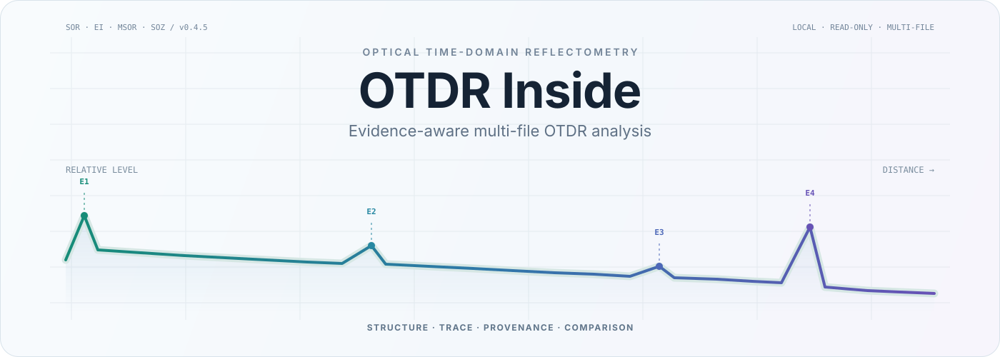
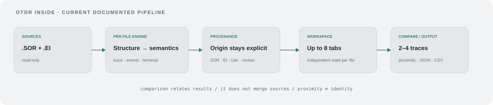

<p align="center">
  <picture>
    <source media="(prefers-color-scheme: dark)" srcset="https://raw.githubusercontent.com/EstebanErazo500/OTDR_Inside/main/assets/otdr-hero.svg">
    <source media="(prefers-color-scheme: light)" srcset="https://raw.githubusercontent.com/EstebanErazo500/OTDR_Inside/main/assets/otdr-hero-light.svg">
    
  </picture>
</p>

<p align="center">
  <strong>Evidence-aware, multi-file analysis of OTDR measurements.</strong><br>
  Safe SOR parsing, vendor-aware interpretation, paired EI/SOR analysis, trace reconstruction and comparative review without losing data provenance.
</p>

<p align="center">
  <a href="#overview"></a>
  <a href="#architecture"></a>
  <a href="#current-capabilities"></a>
  <a href="#current-scope"></a>
  <a href="#validation"></a>
  <a href="#roadmap"></a>
  <a href="technical-documentation/README.md"></a>
</p>

<p align="center">
  <a href="README.md"></a>
  <a href="README.es.md"></a>
</p>

---

<h2 id="overview" align="center">Overview</h2>

OTDR files can be structurally readable while still containing vendor-specific semantics, rewritten metadata, ambiguous scales or different event representations. OTDR Inside addresses that problem by separating **structure**, **interpretation**, **calculation**, **evidence**, **provenance** and, from the 0.4 line, **comparison state**.

The project is not designed to force every trace into a universal model. It exposes what was read, what was interpreted, how a result was derived, which source it belongs to and which claims remain unresolved.

<h2 id="architecture" align="center">Architecture</h2>

<p align="center">
  
</p>

The current documented line keeps per-file analysis separate from the workspace that presents and compares results:

| Layer | Responsibility |
|---|---|
| **Structural parsing** | Reads SOR blocks, revisions, sizes, offsets and sample regions with explicit boundary checks. |
| **Profile & normalization** | Applies vendor-aware rules only when available evidence supports them. |
| **Per-file analysis** | Reconstructs the trace, preserves stored/imported/calculated origins and evaluates event/terminal evidence. |
| **Workspace** | Keeps up to eight analyses in independent tabs with per-file zoom, selection, review and annotations. |
| **Comparison** | Compares two to four traces as a presentation relation without merging their provenance or claiming physical identity. |

The version-by-version architecture and the detailed v0.4.1 snapshot are documented in <a href="technical-documentation/architecture.md">Technical documentation</a>.

<h2 id="engineering-approach" align="center">Engineering approach</h2>

Five distinctions guide the implementation:

- **Structure is not semantics.** A file can be parsed safely while some magnitudes remain uninterpreted.
- **Equipment is not necessarily the file writer.** Proprietary blocks may identify a software lineage without proving which OTDR acquired the trace.
- **Stored is not calculated.** Analysis results remain distinguishable from information present in the measurement source.
- **Proximity is not identity.** Similar event positions across traces are useful for review but do not prove the same physical event, link or measurement accuracy.
- **Unknown is not corrupt.** Unsupported semantics remain explicit instead of being silently guessed.

### Provenance-aware normalization

```python
normalized_field = {
    "value": ...,
    "raw_value": ...,
    "unit": ...,
    "source": ...,
    "rule_id": ...,
    "confidence": ...,
    "evidence": ...,
}
```

An empirical conversion, vendor-specific scale or inferred meaning therefore remains distinguishable from a value explicitly stored in the source.

<h2 id="current-capabilities" align="center">Current capabilities</h2>

The archived development line documented through **v0.4.2** includes:

- safe inspection of SOR 2.00 structure and metadata;
- evidence-based selection of characterized vendor profiles;
- trace reconstruction from stored samples;
- defensive `.EI` reading for the characterized CE6422 layout and evidence-based EI/SOR pairing;
- explicit separation of SOR-stored events, EI-imported records, calculated candidates and manual review;
- contextual event analysis, explainable suppression and terminal evidence;
- a v0.3.6 consistency pass for equivalent EI/SOR curves and weak-response localization;
- up to **eight files open in independent tabs** from v0.4.0;
- explicit EI association initiated from a SOR tab instead of filename-based pairing;
- comparison of **two to four traces** with acquisition conditions, curve overlay, event proximity and CSV export;
- v0.4.1 comparison across any selected pair, with **common-span / full-span** views and a 5–50 m median drawing baseline;
- v0.4.2 comparison audit showing event-evidence grades and nearby **suppressed candidates** without counting them as matches;
- v0.4.2 terminal sensitivity warnings from a ±10% diagnostic perturbation of the minimum-noise threshold, **without changing the default detector decision**;
- an **optional, reversible, class-aware experimental edge locator** alongside the unchanged baseline positions, with method/version recorded in sessions and exports;
- revised local reports/PDF layouts and session controls, while preserving read-only source handling;
- organized diagnostics that separate readable data, actionable findings, warnings and methodological detail;
- JSON/CSV exports without modifying the original measurement.

<h2 id="current-scope" align="center">Current scope · documented through v0.4.2</h2>

| Ecosystem | Status | Role in the project |
|---|---|---|
| **EXFO** | **Validated reference** | SOR 2.00 parsing, normalized parameters, stored events and trace visualization for the characterized reference profile. |
| **Ceyear CE6422** | **Active development** | Characterized trace interpretation, calculated candidates, verified EI/SOR pairing for the observed layout, terminal diagnostics and multi-file comparison. |
| **Yokogawa AQ1000** | **Structural** | File structure characterized; vendor-specific semantic normalization remains pending. |

<p align="center"><strong>structurally readable → profile identified → semantically characterized → empirically validated</strong></p>

<h2 id="event-provenance" align="center">Event provenance</h2>

Event origin is preserved as part of the model rather than flattened into one table:

- **SOR stored** — event information serialized in the SOR, such as `KeyEvents` when present;
- **EI imported** — records read from a supported EI layout, with verified-pair state kept explicit;
- **Calculated candidate** — hypotheses generated from the reconstructed curve, including terminal candidates;
- **Manual review** — user review or annotation state that does not alter the source measurement.

The v0.4 workspace adds another rule: placing several traces in one comparison does **not** create a new event origin. v0.4.1 groups nearby positions for review while retaining the source file and provenance of every item. v0.4.2 surfaces nearby excluded proposals and their suppression reasons **without presenting them as accepted matches**. A changed experimental position remains calculated, with the baseline and method recorded.

For the characterized Ceyear family, absence of `KeyEvents` means **no stored event table was found in that SOR**; it does not mean the optical trace contains no events.

<h2 id="validation" align="center">Validation</h2>

Validation is layered rather than reduced to one pass/fail criterion:

1. structural and boundary checks;
2. profile and semantic regression;
3. trace reconstruction and deterministic event regression;
4. paired EI/SOR consistency where a verified pair is available;
5. private field/reference comparisons with their limitations preserved;
6. workspace, server and simulated DOM/canvas regression;
7. manual viewer and export checks.

Important documented milestones include an archived **80-test release validation in v0.3.6**, verification over **18 controlled EI/SOR pairs** with 72/72 post-start event associations, and the v0.4.1 standard Python suite with **54 tests passing and 6 external-corpus tests skipped**. Counts are not treated as directly comparable quality scores because the suites and required data changed between releases.

The archived v0.4.2 presentation revision reports **92 Python tests passed with the available controlled/private corpora** and simulated DOM tests. The optional class-aware edge method improved *retrospective concordance* against an EXFO study reference but worsened agreement with paired EI; therefore it remains **experimental and off by default**, not a validated accuracy correction.

The full evidence hierarchy, public/private boundary and metrological limits are described in <a href="technical-documentation/validation.md">Validation</a>.

<h2 id="data-handling" align="center">Data handling</h2>

OTDR Inside is designed as a **local, read-only workflow**. Source measurements are processed locally and are not overwritten by the viewer.

This repository does not distribute real operational `.sor`, `.ei` or `.otdr` measurements, customer or route identifiers, private corpus filenames or hashes, proprietary vendor executables, commercial manuals, licensed standards, or derived evidence that exposes confidential trace metadata. Public examples and tests should rely on synthetic or explicitly sanitized data.

<h2 id="known-limitations" align="center">Known limitations</h2>

- `.EI` support is limited to the observed and characterized Ceyear layout; it is not universal EI compatibility. `.otdr` is not part of the normal processing path.
- Vendor-specific interpretation remains profile/signature based and should not be read as universal SOR compatibility.
- The displayed vertical trace level is relative and is not presented as universally calibrated optical power.
- Event proximity in the v0.4.1 comparator is a **visual grouping aid**, not a physical tolerance or proof that two traces contain the same event.
- The v0.4.2 class-aware edge locator is optional, reversible and not a demonstrated physical-accuracy improvement. Terminal-threshold sensitivity is a diagnostic warning, not uncertainty calibration.
- Common/full-span switching and the 5–50 m median baseline affect comparison presentation only; they do not modify samples, event positions or losses.
- Terminal results remain calculated hypotheses and do not certify physical fiber endpoints, event loss, reflectance, ORL or metrological uncertainty.
- OTDR Inside does not claim independent Telcordia SR-4731 certification.

<h2 id="roadmap" align="center">Roadmap</h2>

- validate event and terminal classes against additional independent references and repeated acquisitions;
- strengthen multi-trace association beyond the current visual proximity grouping without turning it into an identity claim;
- expand paired-format and vendor coverage while preserving provenance checks;
- add batch processing, duplicate detection and anomaly review;
- publish synthetic/sanitized regression fixtures and CI as the code migration progresses;
- build a compatibility matrix based on reproducible evidence.

<h2 id="author" align="center">Author</h2>

<p align="center">
  <strong>Esteban Erazo</strong><br>
  Mechatronics Engineering · Universidad Nacional de Colombia<br><br>
  <a href="https://github.com/EstebanErazo500"></a>
</p>
