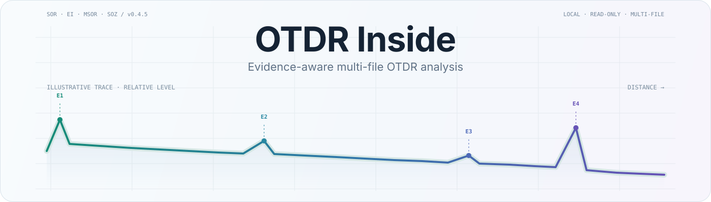
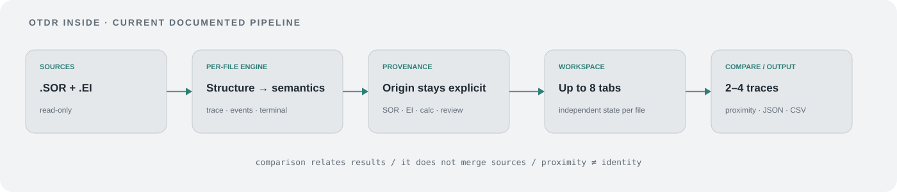

  <picture>
    <source media="(prefers-color-scheme: dark)" srcset="assets/otdr-hero.svg">
    <source media="(prefers-color-scheme: light)" srcset="assets/otdr-hero-light.svg">
    
  </picture>

  <strong>Engineering prototype for multi-format, multi-vendor OTDR analysis.</strong> 
  Binary-format characterization · signal processing · ML advisory · provenance-aware comparison.

  
  
  
  

  
  
  
  

  
  
  
  
  

  
  

---

<h2 id="overview" align="center">Overview</h2>

OTDR files can be structurally readable while still containing vendor-specific semantics, rewritten metadata, ambiguous scales or different event representations. OTDR Inside addresses that problem by separating **structure**, **interpretation**, **calculation**, **evidence**, **provenance** and, from the 0.4 line, **comparison state**.

The project is not designed to force every trace into a universal model. It exposes what was read, what was interpreted, how a result was derived, which source it belongs to and which claims remain unresolved.

### Project at a glance

| Dimension | Documented scope |
|---|---|
| Characterized vendors | EXFO, Ceyear, Yokogawa and JDSU |
| Format families | SOR · EI · MSOR · SOZ |
| Evolution | v0.1.0 to v0.4.5 (consolidated 5 November 2026) |
| Archived v0.4.5 regression | 123 Python tests passed with available internal data |

**Technical portfolio, not a software distribution.** This repository documents development, results and limits. Validation figures are archived evidence, not public CI or certification. Viewer source code and operational measurements remain private. Illustrations are conceptual or synthetic; actual viewer screenshots are not yet included.

<h2 id="current-capabilities" align="center">Current capabilities</h2>

| Capability | Engineering value |
|---|---|
| Multi-format reading | Recover structure, parameters, traces and native events in characterized layouts. |
| Signal processing | Calculated candidates, terminal evidence and local LSA loss estimates for eligible transitions. |
| Advisory machine learning | Random Forest morphology and contextual review without replacing instrument measurements. |
| Instrument comparison | Independent tabs, trace comparison, reviewable associations, conditional IOR and event separations. |
| Traceability | Preserve original values, provenance, interpretation limits and review decisions. |
| Technical reporting | Local exports and reports with analysis and comparison context. |

Detailed capability history by version

The development sequence documented from **v0.1.0 through v0.4.5** includes:

- safe inspection of SOR 2.00 structure and metadata;
- evidence-based selection of characterized vendor profiles;
- trace reconstruction from stored samples;
- defensive `.EI` reading for the characterized CE6422 layout and evidence-based EI/SOR pairing;
- explicit separation of SOR-stored events, EI-imported records, calculated candidates and manual review;
- contextual event analysis, explainable suppression and terminal evidence;
- a v0.3.6 consistency pass for equivalent EI/SOR curves and weak-response localization;
- up to **eight files open in independent tabs** from v0.4.0;
- explicit EI association initiated from a SOR tab instead of filename-based pairing;
- comparison of **two to four traces** with acquisition conditions, curve overlay, event proximity and CSV export;
- v0.4.1 comparison across any selected pair, with **common-span / full-span** views and a 5–50 m median drawing baseline;
- v0.4.2 comparison audit showing event-evidence grades and nearby **suppressed candidates** without counting them as matches;
- v0.4.2 terminal sensitivity warnings from a ±10% diagnostic perturbation of the minimum-noise threshold, **without changing the default detector decision**;
- an **optional, reversible, class-aware experimental edge locator** alongside the unchanged baseline positions, with method/version recorded in sessions and exports;
- revised local reports/PDF layouts and session controls, while preserving read-only source handling;

- v0.4.3 characterized Yokogawa SOR native events and introduced an advisory **Random Forest morphology review**, without rewriting the instrument's measurements;
- v0.4.4 added the characterized **JDSU MSOR** dual-wavelength container and revisable, one-to-one cross-device event associations;
- v0.4.5 added **Yokogawa SOZ** multi-trace containers, preserving each wavelength's own samples, native event table and source identity;
- v0.4.5 compares **EXFO and Yokogawa as peer documentary references**, with JDSU as additional corroboration; reference selection does not make either instrument a physical ground truth;
- configurable original/reference-**IOR axes** (applied only where valid), and differences in **inter-event separation** alongside absolute-position comparison;
- local **LSA loss estimates** with six alternative before/after window combinations, separately presented from the instrument's native loss;
- joint review of **unchanged RF morphology suggestions**, window sensitivity and disagreements, with versioned session and PDF/CSV/JSON context;
- organized diagnostics that separate readable data, actionable findings, warnings and methodological detail;
- JSON/CSV exports without modifying the original measurement.

  
  

<h2 id="contributions" align="center">Engineering contributions</h2>

The development combines mechatronics, applied software and experimental analysis. The table links documented engineering contributions to public evidence without disclosing the proprietary implementation.

| Area | Technical contribution | Evidence |
|---|---|---|
| **Binary-format characterization** | Structure and vendor-semantics analysis; separation of declared and confirmed source identity. |  |
| **Software architecture** | Separation of ingestion, profile-based interpretation, per-file analysis, workspace and comparison. |  |
| **Signal processing** | Candidate and transition evaluation, experimental localization and local LSA loss estimation. |  |
| **Machine learning** | Morphological Random Forest evaluation and advisory use; contextual review and score limits. |  |
| **Instrumentation and metrology** | Comparability, IOR, reference and position/separation analysis while retaining native readings. |  |
| **Experimental validation** | Controlled tests, versioned regression and evaluation of tradeoffs among references. |  |
| **Visualization and interaction** | Trace organization, diagnostics, review, comparison and technical reports. |  |

<h2 id="guided-walkthrough" align="center">Guided walkthrough</h2>

**See the engineering workflow before reading the implementation history.** This five-stage operator journey covers the documented v0.4.5 workflow:

**Open a characterized SOR/EI/MSOR/SOZ → interpret source-aware traces and events → review LSA loss and Random Forest advice → compare traces and acquisition context → retain decisions in session/reports.**

  

The walkthrough includes an original conceptual flow diagram and practical Ceyear, Yokogawa and JDSU routes. **It is not a downloadable demo or screenshot gallery**; source code and operational measurements remain private.

<h2 id="compatibility-matrix" align="center">Compatibility matrix</h2>

Format recognition, native-event support, calculated analysis and vendor-specific optical semantics have **different levels of evidence**. The dedicated matrix documents characterized EXFO SOR, Ceyear SOR/EI, Yokogawa SOR/SOZ and JDSU MSOR paths, including unsupported variants and required preconditions.

  

<h2 id="case-studies" align="center">Case studies</h2>

Two engineering decisions explained using synthetic examples and archived evidence: position disagreements between instruments and native-versus-LSA loss. Includes documented research status.

  

<h2 id="current-scope" align="center">Current scope · documented through v0.4.5</h2>

| Ecosystem | Status | Role in the project |
|---|---|---|
| **EXFO** | **Characterized reference profile** | SOR 2.00 parsing, normalized parameters, stored events and trace visualization for the characterized reference profile. |
| **Ceyear CE6422** | **Active development** | Characterized trace interpretation, calculated candidates, verified EI/SOR pairing for the observed layout, terminal diagnostics and multi-file comparison. |
| **Yokogawa (characterized SOR / SOZ)** | **Characterized native-event support** | Observed SOR event scales and SOZ multi-wavelength members; source-confirmed SOR origins remain distinguishable from instrument-declared identity. Native-reader and metrological confirmation remain bounded. |
| **JDSU T-BERD 6000A / 8126 MSOR** | **Characterized container support** | Observed MSOR 2.10, two wavelengths, native events and verified source-specific reference fields; unknown formats or units remain unsupported. |

<strong>structurally readable → profile identified → semantically characterized → empirically validated</strong>

<h2 id="architecture" align="center">Architecture</h2>

  

The current documented line keeps per-file analysis separate from the workspace that presents and compares results:

| Layer | Responsibility |
|---|---|
| **Structural parsing** | Reads SOR blocks, revisions, sizes, offsets and sample regions with explicit boundary checks. |
| **Profile & normalization** | Applies vendor-aware rules only when available evidence supports them. |
| **Per-file analysis** | Reconstructs the trace, preserves stored/imported/calculated origins and evaluates event/terminal evidence. |
| **Workspace** | Keeps up to eight analyses in independent tabs with per-file zoom, selection, review and annotations. |
| **Comparison** | Compares two to four traces as a presentation relation without merging their provenance or claiming physical identity. |

The version-by-version architecture, the 0.4.1 workspace baseline and the documented 0.4.3–4.5 extensions are explained in <a href="technical-documentation/architecture.md">Technical documentation</a>.

<h2 id="engineering-approach" align="center">Engineering approach</h2>

Five distinctions guide the implementation:

- **Structure is not semantics.** A file can be parsed safely while some magnitudes remain uninterpreted.
- **Equipment is not necessarily the file writer.** Proprietary blocks may identify a software lineage without proving which OTDR acquired the trace.
- **Stored is not calculated.** Analysis results remain distinguishable from information present in the measurement source.
- **Proximity is not identity.** Similar event positions across traces are useful for review but do not prove the same physical event, link or measurement accuracy.
- **Unknown is not corrupt.** Unsupported semantics remain explicit instead of being silently guessed.

### Provenance-aware normalization

*Illustrative conceptual schema, not application source code:*

| Conceptual dimension | Information retained |
|---|---|
| Value | Interpreted value, raw value and unit |
| Provenance | Source and applied rule |
| Support | Interpretation confidence and evidence |

An empirical conversion, vendor-specific scale or inferred meaning therefore remains distinguishable from a value explicitly stored in the source.

<h2 id="event-provenance" align="center">Event provenance</h2>

Event origin is preserved as part of the model rather than flattened into one table:

- **SOR stored** — event information serialized in the SOR, such as `KeyEvents` when present;
- **EI imported** — records read from a supported EI layout, with verified-pair state kept explicit;
- **Calculated candidate** — hypotheses generated from the reconstructed curve, including terminal candidates;
- **Manual review** — user review or annotation state that does not alter the source measurement.

The v0.4 workspace adds another rule: placing several traces in one comparison does **not** create a new event origin. v0.4.1 groups nearby positions for review while retaining the source file and provenance of every item. v0.4.2 surfaces nearby excluded proposals and their suppression reasons **without presenting them as accepted matches**. A changed experimental position remains calculated, with the baseline and method recorded.

For the characterized Ceyear family, absence of `KeyEvents` means **no stored event table was found in that SOR**; it does not mean the optical trace contains no events.

From v0.4.3 onward, a **morphology classifier** can propose a *signal-shape assessment*. This is an advisory result, **not a fifth source of events, calibrated probability or replacement for native event/loss values**. In v0.4.5, estimated LSA loss is also distinct from any instrument-stored loss. SOZ/SOR copies of the same acquisition are linked without counting them as independent measurements.

<h2 id="validation" align="center">Validation</h2>

Validation is layered rather than reduced to one pass/fail criterion:

1. structural and boundary checks;
2. profile and semantic regression;
3. trace reconstruction and deterministic event regression;
4. paired EI/SOR consistency where a verified pair is available;
5. private field/reference comparisons with their limitations preserved;
6. workspace, server and simulated DOM/canvas regression;
7. manual viewer and export checks.

Important documented milestones include an archived **80-test release validation in v0.3.6**, verification over **18 controlled EI/SOR pairs** with 72/72 post-start event associations, and a prior standard-suite run with **54 tests discovered: 48 passed and 6 external-corpus tests skipped**. Counts are not treated as directly comparable quality scores because the suites and required data changed between releases.

The archived v0.4.2 presentation revision reports **92 Python tests passed with the available controlled/private corpora** and simulated DOM tests. The optional class-aware edge method improved *retrospective concordance* against an EXFO study reference but worsened agreement with paired EI; therefore it remains **experimental and off by default**, not a validated accuracy correction.

The archived v0.4.5 consolidation records **123 Python tests passing** with available development corpora; nine characterized SOZ containers exposed 18 wavelength traces and 69 stored events. A controlled set of 54 Ceyear splice-loss LSA estimates contained **49 supported and 5 requiring review**. These are retrospective, dependent comparisons—not calibrated uncertainties or independent physical accuracy. The 6 November comparator patch and further AI studies are tracked as separate research, **not features shipped in the packaged v0.4.5**.

The full evidence hierarchy, public/private boundary and metrological limits are described in <a href="technical-documentation/validation.md">Validation</a>.

<h2 id="data-handling" align="center">Data handling</h2>

OTDR Inside is designed as a **local, read-only workflow**. Source measurements are processed locally and are not overwritten by the viewer.

**Publication scope:** reviewed screenshots of the actual viewer, high-level architecture explanations and independently synthetic/generalized illustrations are permitted. **The viewer's source code is not authorized for publication**, including cleaned or adapted versions, internal tests, configurations, binaries or executable releases. A screenshot must be checked for operational metadata and identifiable trace content before publication.

The repository does not distribute real `.sor`, `.ei`, `.msor`, `.soz`, `.trc`, `.stdr`, `.otdr`, exported measurement/report/session data, private trace curves, route/customer identifiers, device serials, hashes, proprietary vendor software or licensed materials. Synthetic illustrations are labeled as such and are not validation measurements.

  

<h2 id="known-limitations" align="center">Known limitations</h2>

- `.EI`, `.MSOR` and `.SOZ` support is limited to characterized vendor layouts; this is not universal format compatibility. Direct EXFO `.stdr` ingestion and other vendor variants remain outside the packaged v0.4.5. `.otdr` is not the normal processing path.
- RF scores describe morphological suggestions, not calibrated probabilities or physical labels; the model does not overwrite native values. LSA window sensitivity is not calibrated loss uncertainty.
- The 6 November auto-centering/IOR-warning patch and other studies are proposals/isolated experiments, **not incorporated into the 5 November release**.
- Vendor-specific interpretation remains profile/signature based and should not be read as universal SOR compatibility.
- The displayed vertical trace level is relative and is not presented as universally calibrated optical power.
- Event proximity in the v0.4.1 comparator is a **visual grouping aid**, not a physical tolerance or proof that two traces contain the same event.
- The later v0.4.4 reviewable correspondence search of up to 50 m differs from the v0.4.1 visual grouping rule; neither is a physical tolerance.
- The v0.4.2 class-aware edge locator is optional, reversible and not a demonstrated physical-accuracy improvement. Terminal-threshold sensitivity is a diagnostic warning, not uncertainty calibration.
- Common/full-span switching and the 5–50 m median baseline affect comparison presentation only; they do not modify samples, event positions or losses.
- Terminal results remain calculated hypotheses and do not certify physical fiber endpoints, event loss, reflectance, ORL or metrological uncertainty.
- OTDR Inside does not claim independent Telcordia SR-4731 certification.

<h2 id="roadmap" align="center">Roadmap</h2>

- validate event and terminal classes against additional independent references and repeated acquisitions;
- strengthen multi-trace association beyond the current visual proximity grouping without turning it into an identity claim;
- expand paired-format and vendor coverage while preserving provenance checks;
- validate direct EXFO `.stdr` decoding using an authentic permitted sample before claiming support;
- study contextual acquisition-quality and comparison-eligibility checks without automatically rewriting instrument data;
- evaluate the isolated comparator-centering patch and review controls in a real Windows browser;
- add batch processing, anomaly review and independent labels across new links;
- build a curated gallery of approved viewer screenshots and independently synthetic trace illustrations, without publishing source code.

<h2 id="author" align="center">Author</h2>

  <strong>Esteban Erazo</strong> 
  Mechatronics Engineering · Universidad Nacional de Colombia  
  

