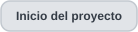
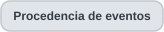
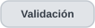
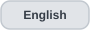

<h1 align="center">Evolución de arquitectura · entregas documentadas</h1>

  
  
  
  
  
  
  

  
  

<strong>Primero leer los bytes. Interpretar solo cuando la evidencia lo permite. Comparar sin borrar las fronteras de origen.</strong>

> **Alcance.** Esta página reconstruye la arquitectura representada por las entregas archivadas desde **v0.1.0 hasta v0.4.5**. Ese rango es un límite documental, no la arquitectura final del proyecto. Las versiones posteriores deben ampliar la línea temporal sin convertir v0.4.1 en un punto de llegada definitivo.

OTDR Inside evolucionó añadiendo capas alrededor de una frontera estable de datos crudos. Primero separó estructura SOR de semántica de fabricante; después incorporó eventos calculados, evidencia, EI como segunda fuente, razonamiento terminal y finalmente un espacio de trabajo multiarchivo que compara trazas sin fusionar su procedencia.

## Mapa de evolución

  
  

## Desarrollo arquitectónico por versión

### v0.1.0–v0.1.2 · columna estructural y envolvente de ejecución

v0.1.0 establece la ruta por archivo que se mantiene:

`SOR → scanner → perfil/normalización → traza → visor`

Lectura estructural e interpretación semántica son responsabilidades distintas desde el comienzo. v0.1.1 y v0.1.2 robustecen arranque y despliegue alrededor de ese motor sin rediseñar la ruta de medición.

### v0.2.0 · la evidencia entra en la interpretación

La semántica de curva Ceyear pasa a una capa de perfiles respaldada por evidencia. Los valores crudos permanecen junto a los normalizados, el soporte se expresa por capacidad y leer estructura deja de equivaler a soporte semántico.

### v0.3.0–v0.3.2 · el análisis de eventos aparece después de la traza

Los candidatos calculados se generan **después** de reconstruir la traza. Los eventos almacenados y los calculados no necesitan compartir categoría de origen.

v0.3.1 separa salida del detector, evidencia y revisión humana. v0.3.2 añade refinamiento contextual y conserva motivos de propuestas suprimidas.

### v0.3.3 · segunda ruta de entrada

Un lector EI defensivo introduce una segunda fuente. El emparejamiento EI/SOR pasa a basarse en evidencia y la información EI obtiene su propia procedencia.

### v0.3.4–v0.3.6 · razonamiento terminal y consistencia entre formatos

v0.3.4 incorpora región terminal diagnóstica y experimentos de localización. v0.3.5 añade una compuerta de evidencia para un posible final no reflectivo. v0.3.6 se concentra en discretización consistente EI/SOR, selección de propuestas duplicadas y localización a tres escalas de respuestas débiles.

Esta fase fortalece el análisis sin cambiar el scanner estructural ni las categorías básicas de procedencia.

### v0.4.0 · el espacio de trabajo se vuelve una capa arquitectónica

El cambio principal de 0.4 no es otro parser: es un **espacio de trabajo alrededor de múltiples análisis independientes**.

v0.4.0 añade:

- hasta ocho pestañas por archivo;
- zoom, selección, anotaciones y revisión aislados por pestaña;
- asociación EI iniciada explícitamente desde una pestaña SOR;
- comparación de dos a cuatro trazas;
- CSV de comparación y condiciones de adquisición;
- diagnóstico reorganizado;
- una regla de competencia terminal más estricta en el detector.

Cada archivo sigue pasando por el mismo motor por archivo. El espacio de trabajo conserva y presenta varios modelos; no los aplana dentro de una sola medición.

### v0.4.1 · se corrige la comparación sin cambiar el detector

v0.4.1 es deliberadamente un refinamiento del espacio de trabajo/presentación.

El módulo `events_hybrid.py` es idéntico byte a byte a v0.4.0. Los cambios importantes aparecen en el front-end:

- agrupamiento de cercanía entre cualquier par seleccionado, no solo respecto al primero;
- vistas tramo común/recorrido completo para alcances distintos;
- referencia vertical por mediana 5–50 m en lugar de la primera muestra;
- atenuación del ruido terminal únicamente para el dibujo comparativo.

Esto demuestra una frontera útil: **la política de comparación puede evolucionar independientemente de la detección de eventos**.

### v0.4.2 · auditoría de evidencia y localización reversible

La documentación archivada de v0.4.2 describe **cambios sucesivos bajo un mismo número de entrega**; no aparece otro scanner estructural ni se sustituye el espacio de trabajo multiarchivo.

El comparador incorpora grados de estabilidad/evidencia visibles y acceso a candidatos excluidos cercanos con sus reglas; los excluidos no cuentan como parejas aceptadas. Un ensayo de ±10 % del umbral mínimo de ruido terminal se usa para **advertir** sobre posibles finales no reflectivos inestables, sin redefinir la lista base de eventos.

Un método experimental `edge_precision.py`, seleccionable por separado, puede desplazar posiciones calculadas de clases soportadas y conserva la posición original, clase, procedencia e historial de revisión. El visor abre en la lectura base. Las posiciones importadas de EI no se reescriben. Sesiones e informes conservan el método y las comparaciones.

Esto es un **ensayo de localización**, no una nueva procedencia ni una mejora universal validada: empeora la concordancia retrospectiva frente a EI aunque mejore frente a la referencia EXFO utilizada en el estudio.

  
  

### v0.4.3 · perfiles de eventos nativos y asesoría morfológica

Yokogawa pasa a tener **semántica caracterizada de eventos SOR nativos**, en lugar de quedar solo en lectura estructural. La identidad declarada por el instrumento se separa de la procedencia confirmada por el usuario cuando los metadatos no declaran fabricante/modelo. Esa confirmación aplica a contenidos específicos sin reemplazar el campo original de proveedor.

Se añade una capa de **revisión morfológica Random Forest** junto al modelo de eventos. Describe la forma de la señal cerca de registros o candidatos; **no** reemplaza origen, posiciones, reflectancia o pérdidas almacenadas. Su puntaje no es probabilidad calibrada ni verdad física.

### v0.4.4 · contenedor JDSU MSOR de dos longitudes de onda

La familia JDSU MSOR 2.10 observada incorpora relaciones **contenedor → subtraza**: un archivo puede guardar dos mediciones por longitud de onda. Cada subtraza conserva muestras, eventos nativos, marcadores y procedencia. Si una magnitud no tiene semántica demostrada se conserva en crudo o se señala no disponible; una referencia TXT verificada no se extrapola a cualquier archivo.

La comparación entre proveedores añade **asociación uno a uno revisable** y selección de referencia. La cercanía propone revisión, no identidad certificada. El borde adaptativo Ceyear sigue claramente en evaluación porque las distintas fuentes de referencia no concuerdan uniformemente.

### v0.4.5 · SOZ, pérdida nativa/estimada y contexto comparativo

La consolidación de v0.4.5 introduce otra familia multitraza, **Yokogawa SOZ**, con selección de onda dentro de una pestaña de contenedor. Las copias SOR vinculadas al SOZ siguen perteneciendo a la misma adquisición y no pueden aumentar artificialmente el tamaño de muestra independiente.

La comparación registra **referencia seleccionada, ejes originales o IOR común condicional, posiciones absolutas y separaciones entre eventos**. Si falta un IOR válido, no se aplica de manera silenciosa el reescalado solicitado. Elegir una referencia no cambia las mediciones originales ni establece el índice físico verdadero.

El análisis por archivo incorpora una **pérdida local estimada LSA** para eventos no reflectivos aptos, con ajustes antes/después de la respuesta. Su valor, seis resultados alternativos de ventanas e indicadores de sensibilidad/revisión se conservan separados de la **pérdida nativa** y de la **sugerencia morfológica Random Forest**. Son tres tipos de información con procedencia y límites distintos.

Sesiones e informes conservan identidad de contenedor/subtraza, método de cálculo, decisiones de comparación y contexto de revisión. El registro de campos orientado por IEC **no** es un certificado de calibración.

  
  

**Después del paquete del 5 de noviembre:** el parche aislado de centrado/aviso IOR, la investigación de lectura EXFO `.stdr` y nuevas propuestas de IA/comparabilidad del 6 de noviembre siguen como investigación o cambios no integrados, no funciones empaquetadas en 4.5.

## Hilo arquitectónico entre versiones

| Aspecto | Estado inicial | Expansión hasta v0.4.1 |
|---|---|---|
| **Estructura** | Lectura SOR segura | Frontera estable de datos crudos en toda la secuencia archivada. |
| **Semántica** | Interpretación por perfiles | Evidencia, estado por capacidad y semántica no soportada explícita. |
| **Eventos** | Eventos EXFO almacenados | Candidatos, IA morfológica consultiva, evidencia, revisión y lógica terminal; origen nativo conservado. |
| **Fuentes** | Solo SOR | Rutas caracterizadas EI, MSOR y SOZ con parejas/copias verificadas. |
| **Estado de sesión** | Un análisis activo | Hasta ocho pestañas independientes con estado propio. |
| **Comparación** | Alternancia manual | Comparación 2–4 y agrupamiento visual entre cualquier par. |
| **Diagnóstico** | Alertas/detalles básicos | Estado legible, hallazgos, advertencias y auditoría técnica. |

Dos componentes permanecen idénticos byte a byte desde v0.1.0 hasta v0.4.2: `scanner.py` y el perfil EXFO validado. El sistema conserva por tanto un contrato estructural de larga duración mientras interpretación e interacción crecen alrededor.

## Base de implementación · v0.4.1 (ampliada hasta v0.4.5)

El diagrama siguiente es la **base por archivo y espacio de trabajo de v0.4.1**. Las ampliaciones 4.2 y 4.3–4.5 se describen en sus respectivos diagramas y apartados anteriores; no se presenta como arquitectura final.

  
  

## Modelo de procesamiento

### 1. Ruta SOR por archivo

1. `scanner.py` valida estructura y expone bloques crudos.
2. `normalizer.py` y los perfiles añaden únicamente semántica soportada.
3. `trace.py` reconstruye distancia y nivel relativo.
4. `events_baseline.py`, `events_hybrid.py`, `event_evidence.py`, `terminal.py` y `localization.py` generan candidatos/diagnósticos conservando origen calculado.
5. `viewer_model.py` construye el modelo por archivo.

### 2. Ruta EI y asociación explícita

`ei_reader.py` y `ei_inspection.py` interpretan de forma defensiva la familia EI observada. Un EI puede abrirse en una pestaña independiente. Para usarlo como compañero, v0.4 exige iniciar la asociación desde una pestaña SOR y superar la verificación por contenido/metadatos.

Una pareja verificada cambia la relación entre archivos, no su procedencia.

### 3. Espacio de trabajo multiarchivo

La capa v0.4 vive principalmente en `web/app.js`:

- hasta ocho análisis pueden coexistir;
- cada pestaña conserva zoom, evento seleccionado, anotaciones y revisión;
- cerrar una pestaña con cambios de sesión sin exportar exige confirmación;
- un archivo rechazado no elimina los análisis que sí pudieron abrirse.

El espacio de trabajo guarda **varios modelos independientes**, no una traza fusionada.

### 4. Capa de comparación

El comparador selecciona de dos a cuatro análisis abiertos.

En v0.4.1:

- agrupa posiciones próximas entre todos los archivos seleccionados;
- conserva eventos sin pareja;
- mantiene como máximo un evento de cada archivo en una fila;
- ofrece tramo común y recorrido completo;
- usa una mediana 5–50 m como referencia visual;
- atenúa el ruido terminal solo en el dibujo.

El comparador no reescribe los resultados por archivo. Construye una **vista de relación** entre resultados existentes.

## Mapa de implementación

| Capa | Módulo(s) archivados | Responsabilidad | Frontera deliberada |
|---|---|---|---|
| **Servidor local** | `visor_otdr.py` | Interfaz HTTP, solicitudes de análisis y recursos estáticos. | Flujo local; no reescribe mediciones fuente. |
| **Lectura estructural** | `scanner.py` | Recorre SOR, valida límites y expone metadatos crudos. | Legibilidad no implica certeza semántica. |
| **Perfiles / normalización** | `normalizer.py`, `profiles/*`, `export_signature.py` | Aplica semántica caracterizada y conserva evidencia/confianza. | Los valores crudos permanecen. |
| **Traza** | `trace.py`, `numerics.py` | Reconstrucción y políticas numéricas. | Nivel relativo ≠ potencia calibrada universal. |
| **Eventos / terminal** | `events_baseline.py`, `events_hybrid.py`, `event_evidence.py`, `terminal.py`, `localization.py` | Genera y audita hipótesis calculadas. | No certifica pérdida, reflectancia, ORL ni final físico. |
| **Interpretación EI** | `ei_reader.py`, `ei_inspection.py` | Lee el diseño EI observado e importa registros soportados. | Las variantes desconocidas no se fuerzan. |
| **Modelo por archivo** | `viewer_model.py` | Combina estructura, semántica, traza, eventos y EI opcional. | La procedencia permanece explícita. |
| **Espacio de trabajo** | `web/app.js`, `web/index.html`, `web/styles.css` | Pestañas, estado de sesión, cambio de archivo, comparación y exportaciones. | Los análisis coexisten sin fusionarse. |
| **Comparador** | funciones v0.4.1 de `web/app.js` | Grupos de cercanía, tramo común/completo y referencia visual. | Cercanía es relación de presentación, no identidad física. |
| **Evidencia/localización v0.4.2** | `edge_precision.py` y cambios de interfaz/informes documentados | Excluidos explicados, sensibilidad terminal y método de posición opcional por clase. | No se sobrescriben silenciosamente el detector base ni los valores EI. |

### Incorporaciones al mapa conceptual hasta v0.4.5

| Nueva responsabilidad | Ruta caracterizada | Frontera |
|---|---|---|
| **Identificación Yokogawa por perfil/procedencia** | Eventos SOR; identidad declarada o procedencia confirmada | La confirmación aplica a archivos concretos, no a todos los semejantes. |
| **JDSU MSOR / Yokogawa SOZ** | Contenedor → subtraza por onda → análisis individual | Un contenedor o copia SOR/SOZ no equivale a varias adquisiciones independientes. |
| **Asesoría morfológica** | Muestras cercanas al evento → sugerencia RF → revisión | El puntaje no es probabilidad calibrada, tipo nativo ni evento físico confirmado. |
| **Pérdida LSA local** | Ventanas anteriores/posteriores → estimación + sensibilidad de seis ventanas | Pérdida estimada y nativa separadas; sensibilidad no es incertidumbre calibrada. |
| **Contexto de comparación/informe** | Referencia paritaria, IOR condicional, posiciones y separaciones | Reexpresar no reescribe ejes nativos ni certifica exactitud. |

## Invariantes arquitectónicos

- **Fuentes de solo lectura.**
- **Estructura antes que semántica.**
- **Crudo antes que normalizado.**
- **Almacenado/importado/calculado permanecen separados.**
- **Pareja EI/SOR por evidencia, no por nombre.**
- **Estado aislado por archivo.**
- **La comparación no modifica el análisis.**
- **Cercanía no es identidad.** Los 15 m del comparador no son tolerancia metrológica.
- **Normalización visual no es calibración.** Tramo común/completo y mediana 5–50 m cambian el dibujo, no la medición.

## Qué no afirma esta arquitectura

El espacio de trabajo v0.4.1 facilita inspección cruzada; no hace físicamente comparables archivos tomados bajo cualquier condición. Posiciones semejantes pueden aparecer en enlaces, longitudes de onda, pulsos o índices distintos sin corresponder al mismo elemento. El agrupamiento actual es codicioso y no se presenta como algoritmo óptimo de asociación física.

La concordancia EI, la referencia EXFO y la evidencia terminal siguen siendo evidencia de ingeniería dentro de condiciones documentadas, no calibración universal ni certificación independiente de Telcordia.

Esta página explica la arquitectura conceptual e histórica. **El repositorio público no incluye código fuente ni archivos de implementación internos.** La <a href="data-handling.es.md">política de manejo de datos</a> define qué puede demostrarse.

---

  
  
  

