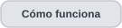

<h1 align="center">Matriz de compatibilidad · OTDR Inside</h1>

  
  
  
  
  
  
  

  
  

<strong>Que un archivo se abra no implica que sus eventos, magnitudes y comparaciones estén validados.</strong>

> **Corte documental: v0.4.5, consolidada el 5 de noviembre de 2026.** Esta matriz resume el comportamiento consignado en las entregas e informes archivados; **no** constituye una ejecución nueva del software, una certificación de conformidad con Telcordia/IEC ni una garantía para todos los equipos de una marca. Las pruebas originales y el código fuente no se publican por las restricciones de [Manejo de datos](data-handling.es.md).

  
  

## Cómo leer el estado

| Estado | Significado técnico |
|---|---|
| **Caracterizado** | Se identificaron estructura y semántica relevante en originales del diseño indicado y existe evidencia de regresión documentada. No implica cobertura universal ni exactitud calibrada. |
| **Condicionado** | La función está documentada para perfiles, clases de evento o relaciones entre archivos específicos y requiere verificar precondiciones. |
| **Solo estructural** | Se puede inspeccionar estructura recuperable sin atribuir automáticamente significados ópticos a todos los campos. |
| **No demostrado** | No hay evidencia suficiente en el registro disponible para afirmar esa capacidad; **no** significa que sea técnicamente imposible. |
| **Investigación / no incorporado** | Hay propuestas o pruebas aisladas, pero no forman parte de la entrega empaquetada v0.4.5. |

Los estados se aplican **por capacidad**, no a una marca completa. También es distinto identificar el modelo dentro del archivo, atribuir su procedencia por evidencia externa y conocer qué software exportó el contenedor.

## 1. Matriz por fabricante y formato

| Ecosistema y formato | Cobertura documentada hasta 4.5 | Eventos y resultados | Alcance / límite decisivo | Desde |
|---|---|---|---|---|
| **EXFO · SOR 2.00** | **Caracterizado:** perfil de referencia FTB-7200, lectura estructural, parámetros normalizados y reconstrucción de curva. | **Caracterizado:** eventos `KeyEvents` cuando existen; posición y magnitudes conforme a los campos admitidos por el perfil. | Es una **referencia documental** del estudio, no un patrón físico infalible ni soporte para todos los EXFO. | 0.1.0 |
| **Ceyear CE6422 · SOR** | **Caracterizado:** curva y parámetros del diseño observado; análisis de candidatos y evidencia terminal. | **Condicionado:** eventos calculados, propuestas suprimidas, revisión RF y LSA local para transiciones aptas. Un SOR sin `KeyEvents` no contiene por ello una tabla de eventos nativos verificable. | El detector no recupera por definición posiciones/pérdidas certificadas. LSA/RF no sustituyen valores instrumentales. | 0.2.0 / 0.3.x / 0.4.5 |
| **Ceyear CE6422 · EI** | **Caracterizado para el diseño binario observado:** lectura defensiva de registros importables; relación con SOR verificada por contenido y adquisición. | **Condicionado:** registros EI importados con su origen propio y comparación frente a candidatos calculados. | No equivale a compatibilidad EI universal ni a emparejamiento por nombre. EI importado no se convierte en `KeyEvents` de SOR. | 0.3.3 |
| **Yokogawa · SOR con identidad declarada** | **Caracterizado:** interpretación de eventos nativos para el perfil registrado en los originales que declaran el modelo AQ1000. | **Caracterizado:** `KeyEvents` originales y magnitudes documentadas, sin reescribir metadatos. | La atribución proviene de los campos declarados por esos archivos; no autoriza inferir soporte de cualquier variante Yokogawa. | 0.4.3 |
| **Yokogawa · SOR con procedencia confirmada externamente** | **Caracterizado en originales concretos:** interpretación del lote cuya fuente fue confirmada, aunque el archivo no declare modelo. | **Caracterizado en ese conjunto:** registros nativos recuperados con los campos originales preservados. | La confirmación **no** debe grabarse como identidad declarada en el archivo ni generalizarse por firma de software. | 0.4.3 |
| **Yokogawa · SOZ** | **Caracterizado:** contenedor multitraza observado, con miembros de 1310 y 1550 nm, muestras y metadatos por subtraza. | **Caracterizado:** tablas nativas por miembro; **condicionado:** vinculación de extracción SOR de la misma adquisición. | Un SOZ y su copia SOR **no** cuentan como dos adquisiciones independientes. Otras variantes SOZ permanecen no demostradas. | 0.4.5 |
| **JDSU T-BERD 6000A / 8126 · MSOR** | **Caracterizado:** contenedor observado **VSRE 2.10**, con dos longitudes de onda, muestras y contexto por subtraza. | **Caracterizado donde existe evidencia:** eventos nativos y campos reconocidos; **condicionado:** asociación de TXT externo verificado. | No extrapolar semántica, unidades ni compatibilidad a otros MSOR/JDSU. Los campos desconocidos siguen desconocidos. | 0.4.4 |
| **SOR de otros perfiles no caracterizados** | **Solo estructural, si el lector acepta el diseño:** inspección de bloques SOR reconocibles. | **No demostrado** para escalas, eventos y magnitudes específicas del fabricante. | Que el archivo se abra **no** implica interpretación óptica correcta; no se declara soporte universal SOR. | Variable |

**Nota de procedencia Yokogawa:** el registro 4.3 separa **24 SOR con identificación declarada** de **24 SOR con procedencia confirmada únicamente para esos originales**. El conjunto archivado recoge 48 archivos y 125 registros nativos; esos totales no constituyen una afirmación sobre archivos futuros de la marca.

## 2. Capacidades transversales y condiciones

| Capacidad | Situación hasta v0.4.5 | Condición de uso / interpretación |
|---|---|---|
| **Lectura estructural y curva** | Caracterizada para los perfiles indicados. | Revisión/organización de bloques, muestras, unidades y eje según el diseño observado. |
| **Eventos nativos y magnitudes almacenadas** | Caracterizada **solo donde existen tablas/campos interpretados**. | Mantener posición, clase, fuente y valor crudo; no calcular valores faltantes como si fueran nativos. |
| **Candidatos calculados y terminales** | Condicionada a la curva y al detector correspondiente. | Conservar método, evidencia, advertencias y rechazo/supresión. Ningún extremo físico está certificado automáticamente. |
| **Asociación Ceyear EI/SOR** | Condicionada a una pareja verificada. | Comprobar contenido y metadatos; conservar separadas ambas procedencias. |
| **Contenedores multionda MSOR/SOZ** | Caracterizada en los diseños JDSU/Yokogawa observados. | Cada subtraza tiene su propia onda, muestras, eventos y origen. |
| **Vinculación SOZ/SOR** | Condicionada a coincidencia verificable de adquisición y datos. | No duplicar estadísticas de adquisiciones independientes. |
| **Espacio multiarchivo** | Documentado: hasta **8 análisis en pestañas** y **comparación de 2–4 trazas**. | Estado/revisión aislados por archivo o subtraza; no mezclar resultados por cambiar de pestaña. |
| **Correspondencia entre eventos** | Propuestas revisables y eventos sin pareja. | La búsqueda de hasta **50 m** en la línea 4.4 sirve para revisión; los **15 m de 4.1** corresponden a un método anterior, no a tolerancia física. |
| **Referencia e índice de grupo (IOR)** | Referencia elegible y reexpresión **condicional** del eje con IOR válido. | Conservar coordenadas originales; si falta IOR no aplicar conversión silenciosa. Reexpresar no calibra el enlace. |
| **Separación entre eventos** | Diferencias relativas entre posiciones incorporadas a la comparación 4.5. | Los intervalos comparten extremos y no son observaciones independientes. |
| **Pérdida de evento nativa** | Disponible donde el formato/perfil tiene semántica interpretada. | Mantenerla distinta de cualquier estimación y no asumir algoritmos idénticos entre marcas. |
| **Pérdida local LSA** | **Condicionada:** transiciones no reflectivas aptas; seis combinaciones de ventanas. | Registrar estimación, apoyo, sensibilidad y discrepancia con dato nativo; **no** es incertidumbre calibrada. |
| **Random Forest morfológico** | **Asesoría contextual**, no medición instrumental. | Los pesos documentados se conservan en 4.5; puntaje no es probabilidad calibrada y no modifica eventos/pérdidas nativos. |
| **Sesiones e informes** | Documentados: decisiones, método, contenedor/subtraza, referencia/eje; PDF, CSV/JSON según flujo. | Salidas locales; no se publican informes ni exportaciones operativas reales. |

## 3. Qué evidencia respalda esta matriz

Los números siguientes proceden de **registros archivados**, no de pruebas realizadas mediante este GitHub.

| Hito | Evidencia documentada | Interpretación permitida |
|---|---|---|
| **EXFO inicial** | Perfil caracterizado y regresión estructural/de traza en la línea 0.1. | Referencia de lectura para el perfil observado. |
| **Ceyear EI/SOR · 0.3.6** | 18 parejas controladas y **72/72** asociaciones posteriores al inicio. | Consistencia del conjunto estudiado; no exactitud absoluta ni enlaces independientes. |
| **Yokogawa SOR · 0.4.3** | **48 archivos**, **125 eventos nativos** recuperados, con procedencia declarada/confirmada diferenciada. | Cobertura del lote observado, no de toda la familia Yokogawa. |
| **JDSU MSOR · 0.4.4** | Lectura y contraste del contenedor dual observado; comparación revisable con referencias. | Caracterización del diseño, no soporte MSOR genérico. |
| **Yokogawa SOZ · 0.4.5** | **9 contenedores → 18 subtrazas → 69 eventos nativos**. | Conservación de estructura, eventos y ondas en el conjunto estudiado. |
| **Ceyear LSA · 0.4.5** | **54 estimaciones**, **49 con apoyo y 5 para revisión**. | Concordancia y revisión contextual; no calibración de pérdidas. |
| **Consolidación · 0.4.5** | **123 pruebas Python** registradas con corpus internos disponibles, además de pruebas DOM simuladas. | Regresión de desarrollo; **no** suite pública ejecutable ni inspección Windows real concluida. |

Para profundizar, consultar [Validación](validation.es.md), [Historial de versiones](version-history.es.md) y [Arquitectura](architecture.es.md).

## 4. Lista de comprobación antes de interpretar dos archivos juntos

1. **Identificar la fuente real:** distinguir fabricante/modelo declarado, software exportador y procedencia confirmada para archivos concretos.
2. **Comprobar la familia del formato:** no extrapolar un perfil SOR, EI, MSOR o SOZ a una variante no caracterizada.
3. **Revisar condiciones de adquisición:** longitud de onda, pulso, alcance, resolución, origen e IOR disponible.
4. **Comprobar relación entre fuentes:** pareja EI/SOR o copia SOZ/SOR verificada; no contar duplicados como ensayos independientes.
5. **Distinguir procedencias:** evento nativo, EI importado, candidato calculado, LSA estimada y recomendación RF no son equivalentes.
6. **Examinar la comparación:** referencia elegida, eje original/reexpresado, correspondencias pendientes y advertencias de pérdidas/ventanas.

**Regla de decisión:** si alguna precondición falta, limitarse a mostrar la información recuperable y **dejar la comparación o magnitud como no demostrada**, sin inventar certeza.

## 5. Fuera de la cobertura empaquetada

| Elemento | Estado documentado |
|---|---|
| **EXFO `.stdr` directo** | Investigación del 6 de noviembre; **no incorporado** a la entrega 4.5. |
| **TRC y variantes EI/MSOR/SOZ no caracterizadas** | **Soporte no demostrado** en el flujo normal v0.4.5. |
| **Parche de centrado vertical / aviso IOR del 6 de noviembre** | Ensayo aislado; **no incluido** en el ZIP 4.5 original. |
| **Modelos de IA adicionales y selector RF alternativo de posiciones** | Evaluación externa o retrospectiva; no reemplazan el Random Forest activo ni las reglas de posición entregadas. |
| **Compatibilidad universal, calibración y certificación Telcordia/IEC** | **No declaradas**. Faltan evidencias independientes y alcance normativo suficiente. |

## Política de actualización

Cada nueva versión debería añadir a esta matriz **modelo/familia y firma**, **formato y variante**, **capacidades exactas**, **fuente de verdad o referencia**, **corpus de verificación sin identificadores privados**, **limitaciones** y **versión de incorporación**. No basta con sumar el nombre del fabricante a una lista de compatibles.

Esta página es una **matriz de cobertura respaldada por evidencia de desarrollo**, no una lista comercial de equipos «certificados».

---

  
  
  

