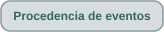

<h1 align="center">Procedencia de eventos · modelo documentado</h1>

  
  
  
  
  
  

  
  

<strong>El origen forma parte de los datos. Evidencia, revisión y cercanía entre trazas son dimensiones diferentes.</strong>

> **Alcance.** Esta página documenta el modelo de procedencia representado por las entregas archivadas hasta **v0.4.2**. Las versiones posteriores pueden añadir relaciones o fuentes, pero no deberían cambiar retroactivamente el significado histórico de estas categorías.

OTDR Inside conserva el origen de cada valor o evento en vez de aplanar todo lo que aparece en la misma interfaz dentro de una tabla indiferenciada.

  
  

## Cuatro orígenes conceptuales

| Origen | Qué significa | Qué no significa |
|---|---|---|
| **Almacenado en SOR** | Evento/valor serializado en el SOR, como `KeyEvents` cuando existe. | No es automáticamente verdad semántica universal para cualquier fabricante. |
| **Importado de EI** | Registro leído de un diseño EI soportado. Una pareja verificada indica además que superó las comprobaciones EI/SOR. | El EI no sobrescribe al SOR ni se convierte en información almacenada en SOR. |
| **Candidato calculado** | Hipótesis derivada de la traza reconstruida y su evidencia. | No fue serializada por el instrumento solo porque aparezca junto a registros almacenados. |
| **Revisión manual** | Estado de revisión, comentario o anotación humana añadida en la sesión. | La revisión no reescribe la medición ni cambia el origen histórico del elemento. |

El modelo no ordena estos orígenes de mejor a peor. La procedencia responde **¿de dónde salió esto?**; evidencia, soporte semántico, revisión y comparación responden otras preguntas.

## Procedencia, evidencia, revisión y comparación no son sinónimos

| Dimensión | Pregunta |
|---|---|
| **Procedencia** | ¿De dónde provino esta información? |
| **Evidencia** | ¿Qué mediciones o contexto respaldan la interpretación? |
| **Estado de revisión** | ¿Qué decidió una persona al revisar? |
| **Soporte semántico** | ¿Qué tan caracterizado está el significado mostrado para este formato/perfil? |
| **Relación de comparación** | ¿Existe un evento visualmente próximo en otra traza seleccionada? |

Un candidato calculado puede tener evidencia fuerte y seguir siendo calculado. Un evento almacenado puede requerir interpretación específica del fabricante. Un candidato aceptado manualmente sigue siendo calculado. Un evento cercano en otro archivo continúa perteneciendo a **ese otro archivo**.

## Ruta SOR · información almacenada y traza reconstruida

Un SOR puede contener estructura de eventos almacenados y muestras de traza al mismo tiempo.

Si existe `KeyEvents`, esa tabla se representa como información almacenada en SOR. La traza puede reconstruirse y analizarse de forma independiente.

Para la familia Ceyear caracterizada, ausencia de `KeyEvents` significa **no se encontró una tabla KeyEvents almacenada en ese SOR**. No demuestra ausencia de eventos ópticos.

El análisis calculado queda por tanto después de la reconstrucción de traza y conserva procedencia calculada.

## Ruta EI · información importada y estado de pareja explícito

Desde v0.3.3, EI es una segunda fuente.

Un EI abierto de forma independiente conserva procedencia EI, pero no afirma un compañero SOR verificado. Una pareja exige la relación de muestras observada y metadatos de adquisición compatibles.

Desde v0.4.0, la asociación se vuelve una acción explícita del espacio de trabajo: el usuario parte de una pestaña SOR y solicita **Asociar EI a este SOR**. Esto hace visible la relación y evita tratar la semejanza del nombre como prueba.

Verificar una pareja fortalece la relación entre archivos; no fusiona sus procedencias.

## Candidatos calculados y evidencia terminal

La ruta calculada evoluciona así:

`traza → propuesta → análisis contextual → evidencia → candidato calculado → revisión humana opcional`

v0.3.5 añade una compuerta de evidencia terminal. Una transición diagnóstica puede convertirse en posible final no reflectivo cuando coincide la evidencia implementada. Si no, permanece como diagnóstico.

v0.3.6 mejora consistencia entre formatos y localización de respuestas débiles sin crear una categoría de procedencia nueva.

## Espacio de trabajo v0.4 · varios orígenes sin fusión

v0.4.0 introduce hasta ocho pestañas. Cada pestaña conserva:

- archivo fuente;
- modelo de vista;
- origen de eventos;
- anotaciones;
- revisión;
- zoom y selección.

El espacio de trabajo no es una medición gigante fusionada; es un contenedor de varios análisis.

Un EI abierto como pestaña independiente es un análisis. Si ese EI se verifica después como compañero de un SOR, la pestaña SOR puede mostrar registros EI como fuente compañera verificada, pero ambas sesiones siguen siendo objetos separados.

## Comparación v0.4.1 · cercanía es relación, no procedencia

El comparador crea una relación entre eventos existentes; **no** crea una nueva fuente.

v0.4.1 agrupa posiciones visualmente próximas entre cualquier par de archivos seleccionados. Cada elemento conserva:

- archivo fuente;
- tipo de evento;
- procedencia original;
- estado propio de análisis/revisión.

El umbral actual de 15 m es una ayuda de agrupamiento. No es:

- tolerancia metrológica;
- prueba de identidad física;
- prueba de que las trazas pertenezcan al mismo enlace;
- nueva puntuación de confianza;
- motivo para reescribir eventos.

El agrupamiento es deliberadamente conservador y puede no ser óptimo cuando existen varios eventos cercanos.

## v0.4.2 · procedencia del método y auditoría de excluidos

v0.4.2 hace más visible el **estado de evidencia de cada candidato** sin cambiar lo que significa procedencia. Un candidato visible puede aparecer como `stable` o `ambiguous`; una propuesta excluida cercana puede consultarse con posición y regla, pero **no** cuenta como pareja de evento visible.

Un ensayo de ±10 % del umbral mínimo de ruido terminal informa sensibilidad de la decisión de posible final no reflectivo; no convierte un aviso diagnóstico en un intervalo de incertidumbre medido.

El método opcional **borde por clase** añade una dimensión diferente: **método de localización**, no fuente de datos. Para un candidato calculado, el visor puede conservar posición base, posición experimental, decisión/motivo y método seleccionado. Al activar el experimento la procedencia sigue siendo **calculada**. Una posición importada de EI permanece **importada de EI** y no se sustituye por la posición experimental del detector.

El método de sesión se registra para restauración e informes. Si cambiar una posición calculada previamente revisada exige nueva revisión, la decisión anterior permanece en el historial en vez de usarse como aprobación automática. La lectura base sigue predeterminada porque los contrastes retrospectivos no favorecen de manera uniforme el experimento.

## La revisión humana se superpone al origen

| Procedencia | Revisión | Significado |
|---|---|---|
| Candidato calculado | Pendiente | Propuesta algorítmica por revisar. |
| Candidato calculado | Aceptado | Aceptado por una persona; el origen sigue siendo calculado. |
| Candidato calculado | Rechazado | Se conserva históricamente pero no se acepta. |
| Importado de EI | Revisado | Registro EI con contexto humano adicional. |
| Almacenado en SOR | Revisado | Información SOR con contexto de revisión. |

## Cómo evolucionó el modelo

| Versión | Cambio relacionado con procedencia |
|---|---|
| **v0.1.0** | Eventos EXFO almacenados diferenciados de la representación cruda/normalizada. |
| **v0.3.0** | Candidatos de curva como fuente calculada explícita. |
| **v0.3.1** | Evidencia y revisión humana como capas separadas. |
| **v0.3.3** | EI como segunda fuente importada con estado de pareja. |
| **v0.3.5** | Evidencia terminal puede respaldar un candidato sin cambiar su origen calculado. |
| **v0.3.6** | Mejora la consistencia EI/SOR sin añadir ni fusionar categorías. |
| **v0.4.0** | Pestañas multiarchivo conservan procedencia/revisión por análisis; asociación EI explícita. |
| **v0.4.1** | Agrupamiento de cercanía entre trazas como relación de presentación, sin tocar procedencia. |
| **v0.4.2** | Grados de evidencia, auditoría de excluidos, sensibilidad terminal y método de localización opcional sin cambiar las fuentes SOR/EI/calculadas. |

## Contrato de presentación y exportación

- el origen permanece visible cuando se muestran varias fuentes;
- SOR, EI y calculado no se fusionan silenciosamente;
- estado de pareja verificada y procedencia EI son conceptos distintos;
- la revisión añade evaluación sin cambiar el origen;
- la comparación añade relaciones sin cambiar el origen;
- valores crudos y semántica no soportada se conservan cuando el modelo lo permite;
- la evidencia terminal puede fortalecer una hipótesis calculada sin convertirla en afirmación física certificada.

## Qué no afirma la procedencia

La procedencia no es una puntuación de verdad. Un valor almacenado no es automáticamente más correcto que cualquier cálculo; un EI importado no equivale a evento almacenado en SOR; aceptar manualmente no crea una nueva medición; y una cercanía entre trazas no demuestra identidad física.

Su objetivo es más concreto: **preservar suficiente contexto de fuente para que interpretación, validación, revisión y comparación posteriores no borren cómo se obtuvo un resultado.**

Esta página documenta conceptos y comportamiento histórico, no distribuye código ni un corpus público de mediciones. Su publicación se rige por la <a href="data-handling.es.md">política de manejo de datos</a>.

---

  
  
  

