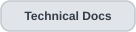
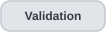

<h1 align="center">Event provenance · documented model</h1>

  
  
  
  
  

  
  

<strong>Origin is part of the data. Evidence, review and cross-trace proximity are different dimensions.</strong>

> **Scope.** This page documents the provenance model represented by archived releases through **v0.4.2**. Later releases may add relationships or sources, but they should not retroactively change what these historical provenance categories mean.

OTDR Inside keeps the origin of a value or event visible instead of flattening everything shown in the same interface into one undifferentiated event table.

  
  

## Four conceptual origins

| Origin | What it means | What it does not mean |
|---|---|---|
| **SOR stored** | Event/value serialized in the SOR source, such as `KeyEvents` when present. | Not automatically a universal semantic truth for every vendor field. |
| **EI imported** | Record read from a supported EI layout. A verified companion additionally means EI/SOR pairing checks passed. | EI data does not overwrite SOR data or become SOR-stored information. |
| **Calculated candidate** | Hypothesis derived from the reconstructed trace and analysis evidence. | It was not serialized by the instrument merely because it appears next to stored records. |
| **Manual review** | Human review state, comments or annotations added during the analysis session. | Review does not rewrite the measurement or change the historical origin of the underlying item. |

The model does not rank these origins from best to worst. Provenance answers **where did this come from?** Evidence, semantic support, review state and cross-trace relationships answer different questions.

## Provenance, evidence, review and comparison are not synonyms

| Dimension | Question |
|---|---|
| **Provenance** | Where did this information come from? |
| **Evidence** | What measurements or local context support the interpretation? |
| **Review state** | What did a human reviewer decide? |
| **Semantic support** | How well is the displayed meaning characterized for this format/profile? |
| **Comparison relation** | Is there a visually nearby event in another selected trace? |

A calculated candidate can have strong evidence and remain calculated. A stored event can still require vendor-specific interpretation. A manually accepted candidate remains calculated. A visually nearby event in another file remains an event from **that other file**.

## SOR path · stored information and reconstructed trace

A SOR may contain stored event structures and trace samples at the same time.

If `KeyEvents` exists, that table is represented as SOR-stored information. The trace can still be reconstructed and analyzed separately.

For the characterized Ceyear family, absence of `KeyEvents` means **no stored KeyEvents table was found in that SOR**. It does not demonstrate that the optical trace contains no events.

Calculated analysis therefore remains downstream of trace reconstruction and receives calculated provenance.

## EI path · imported information with explicit pair state

From v0.3.3, EI becomes a second source.

An EI opened independently keeps EI-imported provenance but does not claim a verified SOR companion. A verified pair requires the observed sample relationship and acquisition metadata checks.

From v0.4.0, pairing becomes an explicit workspace action: the user starts from a SOR tab and requests **Associate EI to this SOR**. That interaction makes the relationship visible and prevents filename resemblance from being treated as proof.

Pair verification strengthens the relationship between two files; it does not merge their provenance.

## Calculated candidates and terminal evidence

The calculated path evolves through the 0.3 line:

`trace → proposal → contextual analysis → evidence → calculated candidate → optional human review`

v0.3.5 adds a terminal-evidence gate. A diagnostic terminal transition can become a possible non-reflective-end candidate only when the implemented terminal evidence aligns. If it does not, the region remains diagnostic.

v0.3.6 improves cross-format consistency and weak-response localization without creating a new provenance category. Equivalent EI/SOR curves can produce more consistent calculated results, but a calculated result still remains calculated.

## v0.4 workspace · multiple origins can coexist without merging

v0.4.0 introduces up to eight open file tabs. Each tab retains its own:

- source file;
- view model;
- event origins;
- annotations;
- review state;
- zoom and selection state.

This matters because the workspace is not one big merged measurement. It is a container for several analyses.

If an EI is opened independently, it is one analysis. If the same EI is later verified as a companion to a SOR tab, the SOR tab may present the EI-imported records as a verified companion source, but the independent tab and the SOR analysis are still separate session objects.

## v0.4.1 comparison · proximity is a relation, not provenance

The comparator creates a relation across existing events; it does **not** create another source category.

v0.4.1 groups positions that are visually close across any selected pair of files. Every item in the comparison still keeps:

- its source file;
- its event type;
- its original provenance;
- its own analysis/review state.

The current 15 m threshold is a display grouping aid. It is not:

- a metrological tolerance;
- proof that two events are physically identical;
- proof that the traces belong to the same link;
- a new confidence score;
- a reason to rewrite either event.

The grouping is intentionally conservative and may be non-optimal when several events are close together.

## v0.4.2 · method provenance and excluded-candidate audit

v0.4.2 makes **candidate status** more visible without changing what event provenance means. A visible candidate can be marked `stable` or `ambiguous`; a nearby suppressed proposal can be inspected with its position and suppression reason, but it is **not** counted as a matching visible event.

A ±10% perturbation of the terminal minimum-noise threshold reports sensitivity of a possible non-reflective-end decision; it does not convert a diagnostic warning into a measured uncertainty interval.

The optional **class-aware edge method** creates another dimension: **localization method**, not another data source. For a calculated candidate, the viewer can retain the baseline position, experimental position, decision/reason and selected method. Choosing the experiment leaves event provenance **calculated**. An imported EI position remains **EI imported** and is not replaced by the detector's experimental position.

The method selected in a session is recorded for restoration and reporting. If changing a previously reviewed calculated position requires renewed review, the previous decision remains in the history rather than being silently reused as approval for the new position. The baseline reading stays the default because retrospective reference comparisons do not consistently favor the experiment.

## Human review overlays the source

Human review remains additive.

| Provenance | Review state | Meaning |
|---|---|---|
| Calculated candidate | Pending | Algorithmic proposal awaiting assessment. |
| Calculated candidate | Accepted | Reviewer accepted the proposal; provenance remains calculated. |
| Calculated candidate | Rejected | Proposal is retained historically but not accepted. |
| EI imported | Reviewed | EI record with added reviewer context; origin remains EI. |
| SOR stored | Reviewed | Stored information with reviewer context; origin remains SOR. |

## How the provenance model evolved

| Release | Provenance-related change |
|---|---|
| **v0.1.0** | Stored EXFO events are kept distinct from raw/normalized file representation. |
| **v0.3.0** | Curve-derived candidates become an explicit calculated source. |
| **v0.3.1** | Evidence and human review become separate layers. |
| **v0.3.3** | EI becomes a second imported source with explicit pair state. |
| **v0.3.5** | Terminal evidence can support a calculated end candidate without changing its origin. |
| **v0.3.6** | EI/SOR consistency improves without adding or merging provenance categories. |
| **v0.4.0** | Multi-file tabs preserve provenance and review state per analysis; EI association becomes explicit. |
| **v0.4.1** | Cross-trace proximity grouping is added as a presentation relation while event provenance stays untouched. |
| **v0.4.2** | Evidence grades, excluded-proposal audit, terminal sensitivity and an optional localization method are tracked without changing SOR/EI/calculated source categories. |

## Presentation and export contract

The public model should preserve these invariants:

- origin remains visible when several sources are displayed together;
- SOR, EI and calculated records are never silently merged;
- verified pair state is distinct from EI provenance;
- review adds assessment without rewriting source origin;
- comparison adds relationships without rewriting source origin;
- raw values and unsupported semantics remain available where supported;
- terminal evidence can strengthen a calculated hypothesis without turning it into a certified physical claim.

## What provenance does not claim

Provenance is not a truth score. A stored value is not automatically more physically correct than every calculated value; an EI import is not equivalent to a SOR-stored event; a human acceptance is not a new measurement; and a close event in another trace is not proof of physical identity.

The purpose is narrower: **preserve enough source context that later interpretation, validation, review and comparison do not erase how a result was obtained.**

---

  
  
  

