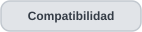

<h1 align="center">Cómo funciona OTDR Inside · Recorrido guiado</h1>

  
  
  
  
  
  
  

  
  

<strong>De un archivo OTDR a una interpretación revisable, sin borrar el origen de los datos.</strong>

> **Alcance verificable.** Este recorrido explica el comportamiento documentado de la entrega **v0.4.5 consolidada el 5 de noviembre de 2026**. No es un tutorial de instalación: el código fuente y el ejecutable del visor no se distribuyen públicamente. Los nombres de controles exactos pueden variar entre revisiones; solo se menciona un control textual cuando el historial lo identifica. Las ilustraciones de esta página son **diagramas originales del flujo**, no capturas del programa ni mediciones de campo.

  
  

## Antes de comenzar · archivos y condiciones

El análisis parte de archivos cuya procedencia de adquisición sea conocida. La compatibilidad es **por formatos y diseños caracterizados**, no por extensión universal.

| Fuente | Ejemplo de recorrido | Precaución |
|---|---|---|
| **EXFO SOR** | Abrir una traza, revisar eventos nativos y usarla como referencia documental. | La referencia no es una verdad física calibrada por definición. |
| **Ceyear CE6422 SOR + EI** | Abrir el SOR y asociar su EI cuando la comprobación de contenido y adquisición sea satisfactoria. | No relacionar archivos solo por nombres parecidos. |
| **Yokogawa SOR / SOZ** | Revisar eventos SOR o elegir subtraza de 1310/1550 nm dentro del contenedor SOZ. | La identidad declarada dentro del archivo puede diferir de una procedencia confirmada externamente. |
| **JDSU MSOR** | Abrir un contenedor caracterizado y examinar cada longitud de onda con sus eventos. | El soporte documentado corresponde al diseño MSOR observado, no a todas las variantes. |

Para consultar las capacidades, condiciones y límites exactos por fabricante, utiliza la matriz específica. Reconocer una extensión no demuestra compatibilidad semántica completa.

  

Antes de comparar mediciones, conviene revisar **longitud de onda, anchura de pulso, alcance, índice de grupo (IOR), origen de distancia y relación entre adquisiciones**. Un SOZ y su extracción SOR pueden representar la *misma* adquisición, no dos repeticiones.

## 1. Abrir y organizar mediciones

**Acción del operador.** Abrir uno o varios archivos dentro de los formatos caracterizados. El espacio de trabajo de la línea v0.4 permite hasta **ocho análisis abiertos en pestañas independientes**. En un MSOR o SOZ multitraza se selecciona la subtraza por longitud de onda conservando el contenedor como fuente.

**Qué debe observarse.** Para cada fuente, el visor organiza los metadatos recuperables, su condición de interpretación y la curva cuando existe soporte. Las pestañas mantienen zoom, evento seleccionado, anotaciones y revisión propios.

**Ruta específica EI/SOR.** La vinculación se inicia desde el SOR mediante la función documentada como **«Asociar EI a este SOR»** y requiere comprobación de contenido/metadatos. Un EI abierto de forma independiente no queda automáticamente verificado como compañero.

**Decisión técnica.** Un error de lectura o un formato no caracterizado no autoriza completar unidades, posiciones o eventos por suposición. El flujo es local y de solo lectura; el original permanece intacto.

## 2. Interpretar la curva y los eventos

**Acción del operador.** Elegir la pestaña/subtraza y revisar el perfil detectado, las condiciones de adquisición, la reconstrucción de la curva y los registros de eventos disponibles.

**Qué debe distinguirse.**

| Elemento | Cómo se interpreta |
|---|---|
| **Evento nativo SOR/MSOR/SOZ** | Registro almacenado por la fuente; conservar su clase, posición y magnitudes donde la semántica esté caracterizada. |
| **Registro importado EI** | Valor proveniente del formato EI observado, con relación EI/SOR verificada o no verificada expresada por separado. |
| **Candidato calculado** | Resultado del análisis de la señal, con evidencia, clase y método; no es un evento almacenado por el instrumento. |
| **Propuesta suprimida** | Candidato excluido que puede consultarse con su motivo; no cuenta como evento aceptado o pareja automática. |
| **Revisión humana** | Estado o anotación añadida; no cambia el origen histórico del valor. |

La curva muestra un **nivel relativo**, no potencia óptica universalmente calibrada. Si falta `KeyEvents` en un SOR, solo falta esa tabla: no se ha demostrado ausencia de eventos físicos. Los posibles finales reflectivos/no reflectivos exigen revisar su evidencia y advertencias, no considerarlos extremos certificados.

**Resultado de esta etapa.** Una traza interpretada con un inventario de qué está *almacenado*, *importado*, *calculado*, *suprimido* o *pendiente de revisión*.

## 3. Revisar evidencia, pérdidas e IA

**Acción del operador.** Elegir un evento pertinente y examinar sus magnitudes originales, evidencia local y, cuando el perfil lo permita, estimaciones adicionales.

**Pérdida local LSA (v0.4.5).** Para transiciones no reflectivas aptas, el visor estima pérdida mediante ajustes locales antes/después del evento y **seis combinaciones de ventanas**. Se revisan apoyo, sensibilidad y desacuerdo con la pérdida nativa; *LSA calculada* y *pérdida almacenada* permanecen como datos distintos. Una estimación marcada «revisar» no debe comunicarse como pérdida certificada.

**Asesoría morfológica Random Forest.** El modelo describe patrones de forma de señal que pueden ayudar a priorizar revisión. Su recomendación se contrasta con las ventanas y posibles discrepancias de signo/forma. **No** reescribe la clase o pérdida nativa, ni su puntuación es una probabilidad calibrada.

**Localización y terminal.** La familia v0.4.2–4.5 conserva el método base y documenta opciones experimentales de borde, con su método/posición registrados. La perturbación diagnóstica de ±10 % del umbral terminal alerta de sensibilidad; no equivale a incertidumbre metrológica. Una alternativa experimental no se acepta automáticamente solo porque coincida mejor con una referencia.

**Decisión técnica.** Mantener el resultado con procedencia y advertencias; solicitar revisión cuando las ventanas, el registro nativo y la asesoría de IA no coinciden.

## 4. Comparar trazas entre formatos o equipos

**Acción del operador.** Seleccionar entre **dos y cuatro trazas** ya abiertas y examinar primero si su comparación tiene sentido: onda, pulso, IOR, origen, alcance y si corresponden al mismo enlace o adquisición.

**Qué permite comparar la línea v0.4.5.** Superposición gráfica, condiciones de adquisición, posiciones de eventos, propuestas de correspondencia revisables, eventos sin pareja y **diferencias de separación entre eventos**. El operador puede elegir referencia y revisar el eje IOR original o su reexpresión condicional con un índice de referencia válido.

**Cómo leer una correspondencia.** EXFO y Yokogawa se tratan como **referencias documentales pares** dentro del montaje estudiado y JDSU aporta otra fuente de corroboración. Ninguna se vuelve verdad física al seleccionarla. Las propuestas de proximidad de la línea v0.4.4 (hasta **50 m** en el flujo caracterizado) se someten a revisión y no son tolerancia instrumental. Los **15 m** descritos para v0.4.1 pertenecen a aquella regla histórica, no deben confundirse con la propuesta posterior.

**Qué no debe hacerse.** Contar SOR/SOZ del mismo registro como adquisiciones independientes; mezclar ondas diferentes como si las condiciones fueran equivalentes; aplicar una conversión IOR si falta un valor válido; interpretar una menor diferencia de posiciones como exactitud física demostrada.

## 5. Conservar la sesión y generar el informe

**Acción del operador.** Registrar las decisiones de revisión y el contexto de comparación. Cuando corresponde, generar los formatos de salida documentados (informes PDF y exportaciones CSV/JSON) y conservar el estado de la sesión.

**Qué debería poder auditarse.** Versión y método empleado, fuente/contenedor/subtraza, condiciones de adquisición, referencia/eje elegidos, datos nativos separados de valores calculados, advertencias, propuestas de correspondencia y evaluación humana. El archivo de medición original no se sobrescribe.

**Límite.** Los campos de informe orientados por IEC son apoyo documental, **no** certificación IEC. Ningún informe con mediciones operativas está autorizado para este repositorio público.

## Tres recorridos representativos

| Necesidad | Ruta de análisis | Pregunta que ayuda a responder |
|---|---|---|
| **Ceyear SOR + EI** | Abrir SOR → verificar asociación EI → revisar candidatos/terminal → examinar LSA y contexto RF. | ¿Qué propuso el algoritmo, qué informa EI y qué requiere revisión? |
| **Yokogawa SOZ** | Abrir contenedor → escoger 1310 o 1550 nm → revisar eventos almacenados → relacionar una extracción SOR si se verifica. | ¿Qué conserva cada subtraza y cuáles archivos son copias de la misma adquisición? |
| **Comparación con JDSU MSOR** | Abrir MSOR → elegir subtraza → seleccionar otra fuente compatible → revisar correspondencias, IOR y separaciones. | ¿Qué coincidencias son defendibles y cuáles dependen de condiciones diferentes? |

## Qué es demostración y qué es validación

Este recorrido **no es una sesión de prueba ejecutada ahora**. Resume operaciones y decisiones registradas en las entregas de desarrollo. Las cifras y límites retrospectivos se encuentran en [Validación](validation.es.md); la evolución de las funciones, en [Historial de versiones](version-history.es.md); y la separación de fuentes, en [Procedencia de eventos](event-provenance.es.md).

Las **capturas reales** del visor aún no están incluidas: deben obtenerse de una sesión autorizada, revisarse y publicarse por separado de acuerdo con [Manejo de datos](data-handling.es.md). No se reemplazan por imágenes externas que aparenten ser pantallas de OTDR Inside.

**Fuera de la entrega empaquetada v0.4.5:** el parche aislado de centrado vertical/avisos IOR del 6 de noviembre, la lectura directa EXFO `.stdr` en investigación y los ensayos de modelos adicionales. No deben aparecer en una demostración como funciones ya entregadas.

---

  
  
  

