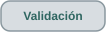

<h1 align="center">Validación · jerarquía de evidencia y límites documentados</h1>

  
  
  
  
  
  

  
  

<strong>La validación es una jerarquía de evidencia, no una única puntuación de exactitud.</strong>

> **Alcance.** Esta página resume el modelo de validación documentado por las entregas archivadas hasta **v0.4.2**. Las trazas operativas y los corpus privados permanecen fuera del repositorio, por lo que se publican métodos y resultados agregados sin exponer rutas, clientes, nombres de archivos privados ni hashes.

  
  

## Capas de validación

| Capa | Qué se comprueba | Qué permite respaldar |
|---|---|---|
| **Seguridad estructural** | Límites de bloques, revisiones, tamaños, rutas y entradas inválidas. | El archivo puede inspeccionarse sin aceptar estructura malformada como datos válidos. |
| **Regresión semántica de perfiles** | Reglas conocidas, valores crudos/normalizados y estados no soportados. | Un significado concreto está respaldado para un perfil caracterizado. |
| **Reconstrucción de traza** | Muestras, eje de distancia, nivel relativo y determinismo. | La curva mostrada es reproducible bajo la interpretación documentada. |
| **Regresión de eventos / terminal** | Posiciones/clases, motivos de exclusión, lógica terminal y salida determinista. | El algoritmo se comporta consistentemente en los casos probados. |
| **Consistencia de formatos emparejados** | Relación EI/SOR, metadatos y asociación de eventos. | Dos formatos relacionados se manejan consistentemente dentro de la familia caracterizada. |
| **Regresión de espacio de trabajo / comparación** | Pestañas, estado aislado, asociación EI, agrupamiento y reglas de dibujo. | La interacción multiarchivo preserva resultados por archivo y aplica la lógica de presentación documentada. |
| **Revisión manual / referencia** | Renderizado, software de referencia e inspección de campo. | La interfaz e interpretación pueden contrastarse externamente conservando sus límites. |

Ninguna capa por sí sola convierte el proyecto en un estándar OTDR calibrado.

## Evidencia pública y evidencia privada

| Tipo de evidencia | Repositorio público | Uso |
|---|---|---|
| Diagramas conceptuales e ilustraciones sintéticas independientes | **Permitidos** | Explicar arquitectura, tipos de evento e interfaz sin revelar implementación. |
| Capturas reales del visor | **Permitidas tras revisar cada imagen** | Demostrar una versión, retirando metadatos identificables y contenido de mediciones operativas. |
| Métodos y resultados agregados de validación | **Documentables tras revisar** | Describir alcance, supuestos de referencia, límites y preguntas abiertas. |
| Código fuente, pruebas internas, scripts, perfiles propietarios y construcción | **Sin autorización de publicación** | La implementación permanece fuera de GitHub aunque se renombre o anonimize. |
| SOR/EI operativos, muestras, eventos, sesiones exportadas, curvas derivadas y datos de clientes | **Privados** | La validación de campo/referencia queda en el entorno autorizado. |
| Ejecutables de fabricantes, manuales comerciales y normas licenciadas | **No se redistribuyen** | Citar o enlazar fuentes legítimamente disponibles cuando sirva. |

Las cifras de pruebas documentadas provienen de informes de desarrollo archivados. **Con el alcance vigente no se prevé migrar código fuente ni crear una suite pública ejecutable en CI.** Véase la <a href="data-handling.es.md">política de manejo de datos y publicación</a>.

## Evidencia por versión

### v0.1.0 · base automatizada

La primera rebanada vertical archivada registra **23 pruebas automáticas aprobadas** alrededor del parser, perfiles, traza y visor.

### v0.3.2 · punto de control del detector

El material archivado de 0.3.2 registra **59 pruebas** con material controlado Ceyear y EXFO. También documenta mejor recuperación de referencias intermedias, dejando claro que esas referencias **no eran datos ciegos**.

La concordancia de desarrollo es evidencia de progreso, no una estimación independiente de exactitud.

### v0.3.4 y v0.3.5 · crece la regresión terminal

Los resultados archivados registran **71 pruebas** en v0.3.4 y **76 pruebas** en v0.3.5 a medida que se incorporan diagnóstico y evidencia terminal. El aumento de conteo refleja cobertura adicional, no una puntuación de calidad directamente comparable.

### v0.3.6 · consistencia entre formatos emparejados

La validación de liberación de v0.3.6 registra:

| Comprobación | Resultado documentado |
|---|---|
| Validación de liberación | **80 pruebas aprobadas** |
| Parejas EI/SOR controladas | **18** |
| Muestras útiles complementarias comprobadas | 18 × 16.384 |
| Registros EI posteriores al inicio asociados con candidatos | **72/72** |
| Candidatos calculados extra en ese corpus de parejas | **0** |
| Índices/clases entre análisis EI/SOR | Coinciden en las 18 parejas |
| SOR privados de campo examinados | **27** |
| Trazas con índices/clases sin cambio frente a v0.3.5 | **22** |
| Trazas con cambios que requieren revisión | **5** |

El informe archivado también registra una diferencia absoluta media SOR frente a EI de **3,782 m** y máxima de **17,154 m** en el conjunto controlado. Esas cifras se presentan como concordancia bajo condiciones estudiadas, **no como exactitud del OTDR ni incertidumbre**.

La versión mejora de forma puntual la localización de una respuesta débil, pero el propio informe la clasifica como validación retrospectiva, no independiente.

### v0.4.0 · espacio de trabajo y competencia terminal más estricta

v0.4.0 vuelve a ejecutar el detector sobre:

- **27 SOR privados de campo**;
- **18 parejas EI/SOR controladas**.

Las parejas mantienen **72/72 asociaciones**, sin candidatos calculados adicionales sin pareja. Frente a v0.3.6, solo una traza privada cambia de clase terminal bajo la regla reflectiva más estricta.

La conclusión es acotada: la regla afecta el caso terminal esperado y conserva el comportamiento del corpus controlado. No certifica el extremo físico.

### v0.4.1 · regresión del comparador

v0.4.1 conserva el detector de v0.4.0 y valida la capa de comparación corregida.

La validación archivada registra:

- **54 pruebas Python aprobadas**;
- **6 pruebas de corpus externo omitidas** en el descubrimiento estándar;
- JavaScript de producción con DOM/canvas simulado;
- agrupamiento entre todos los pares en el caso probado;
- cambio entre tramo común y recorrido completo;
- referencia visual por mediana 5–50 m en el caso atípico probado;
- conservación del estado por pestaña y asociación EI explícita.

En el momento de esa validación quedaba pendiente una inspección visual final del comparador revisado en un navegador Windows real. Esa comprobación pendiente se conserva como parte del registro.

### v0.4.2 · evidencia visible, bordes experimentales e informes

El archivo de validación de v0.4.2 documenta varias revisiones con **el mismo número de versión**.

| Etapa documentada | Evidencia |
|---|---|
| Auditoría inicial del comparador (29 de septiembre) | 55 pruebas internas correctas; seis omitidas por corpus externo. Se distinguen propuestas visibles y excluidas, y la sensibilidad terminal varía ±10 % el umbral mínimo de ruido. |
| Ensayo numérico de borde (1 de octubre) | Método por clase evaluado retrospectivamente frente a 18 parejas controladas EI/SOR y material de comparación EXFO. Las posiciones base permanecen reproducibles y predeterminadas. |
| Revisión final de presentación documentada (8 de octubre) | **92 pruebas Python aprobadas sin omisiones con los corpus controlados/privados disponibles**, además de pruebas DOM/sesión simuladas. Se renderizaron y revisaron página por página informes PDF de una traza y una comparación. No se probó un navegador Windows real en ese entorno. |

**Se conservan los resultados contradictorios en lugar de ocultarlos en un promedio.**

| Referencia de concordancia (mismos 72 eventos calculados de 18 parejas controladas EI/SOR) | Diferencia absoluta media base | Diferencia absoluta media borde experimental |
|---|---:|---:|
| Comparación EXFO del estudio | **4,399 m** | **2,726 m** |
| EI de la misma adquisición | **3,782 m** | **5,532 m** |

Las 18 parejas son adquisiciones de un montaje controlado, **no 18 enlaces independientes**; los 72 eventos tampoco son 72 enlaces independientes. Además, no está confirmada la identidad física del trayecto medido por EXFO y Ceyear. Estas cifras describen **concordancia retrospectiva entre programas/referencias, no error metrológico**.

Sobre 27 SOR privados de campo, la lectura base reproduce los eventos previos. El modo experimental ajustó 87 de 189 posiciones visibles calculadas y conservó 102. Mantiene los ID/clases y el historial de exclusión, pero **no demuestra que las posiciones ajustadas sean físicamente mejores**. En otro enlace, un contraste exploratorio con eventos almacenados en SOR empeora su diferencia absoluta media de 1,233 m a 1,423 m. El método de borde por clase sigue por tanto **experimental, opcional, reversible y desactivado por defecto**.

Variar el umbral mínimo de ruido terminal permite advertir sensibilidad, **no calcular intervalos de confianza** ni verificar extremos físicos. Mostrar excluidos próximos sirve para auditoría; no se cuentan como parejas visibles.

**Frontera de publicación.** Aquí solo se incluyen resultados metodológicos agregados. Permanecen privados trazas, datos por evento, identificadores del corpus, seriales, hashes, rutas absolutas e informes que revelen metadatos operativos. Las 92 pruebas proceden del documento de validación archivado, **no de CI público** ni de una nueva ejecución de tests en GitHub.

## Por qué el número de pruebas no es una puntuación

Los conteos cambian porque las suites evolucionan:

- aparecen módulos y pruebas nuevas;
- algunas versiones usan corpus externos/privados no disponibles en el descubrimiento estándar;
- ciertas pruebas de navegador o corpus son condicionales;
- una entrega puede concentrarse en detector y otra en interacción multiarchivo.

Por tanto, **80 frente a 54 no significa que una versión esté “más validada” que otra**. Importa qué afirmaciones cubre cada suite y bajo qué datos.

## Límites específicos del comparador

### Umbral de cercanía de 15 m

Es una ayuda visual. No es:

- tolerancia calibrada;
- regla de identidad de eventos;
- prueba de identidad de enlace;
- intervalo de confianza;
- especificación de exactitud.

### Agrupamiento entre todos los pares

v0.4.1 mejora 0.4.0 al revisar cercanía entre todos los archivos seleccionados y no solo contra el primero. El agrupamiento sigue siendo codicioso y puede no ser óptimo cuando hay varios eventos muy cercanos.

### Referencia de nivel y escala horizontal

La mediana 5–50 m, la atenuación del ruido terminal y el selector tramo común/completo son **reglas de dibujo**. No modifican muestras, posiciones, pérdidas ni procedencia.

## Qué haría falta para afirmar exactitud física

Un estudio metrológico requeriría al menos:

- puntos de referencia con distancia trazable e incertidumbre conocida;
- definición explícita del origen;
- índice de grupo y parámetros de adquisición verificados;
- adquisiciones repetidas por onda y pulso;
- etiquetas independientes por clase de evento;
- suficientes repeticiones para estimar variabilidad;
- material de validación ciego no usado para ajustar el detector.

Hasta entonces, las distancias deben describirse como **concordancia algoritmo/referencia bajo condiciones concretas**, no como exactitud universal del OTDR.

## Reglas para documentar la validación públicamente

- conservar crudo y normalizado por separado;
- mantener procedencia almacenada/importada/calculada/manual;
- mantener el código fuente, las pruebas internas y la regresión operacional fuera de GitHub;
- emplear ilustraciones sintéticas independientes y capturas revisadas, sin subir fixtures de pruebas internos o adaptados;
- indicar cuándo una prueba depende de corpus externo;
- separar regresión automatizada de inspección manual de navegador;
- separar cercanía visual de tolerancia física;
- conservar evidencia negativa, fallida o pendiente en lugar de publicar solo éxitos.

---

  
  

Frontera de publicación: capturas y arquitectura permitidas tras revisión; código fuente de la aplicación excluido.

